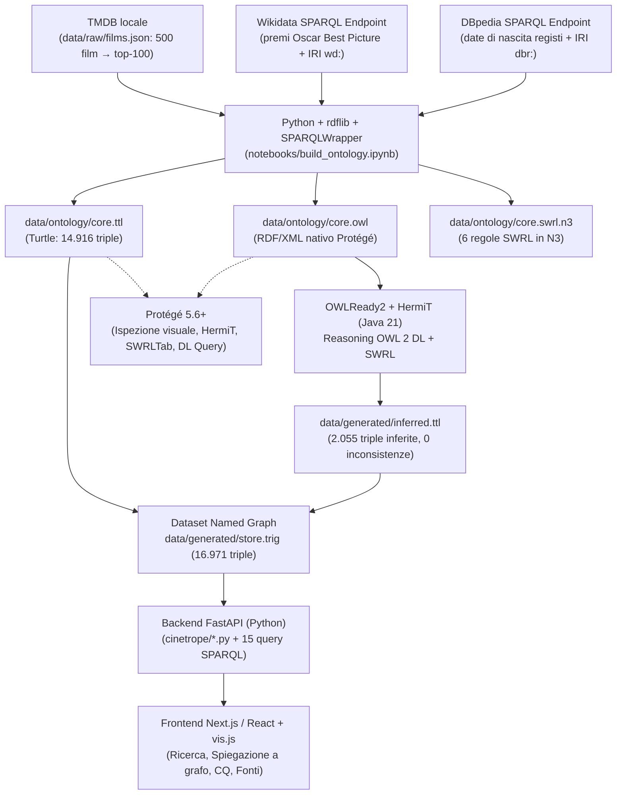
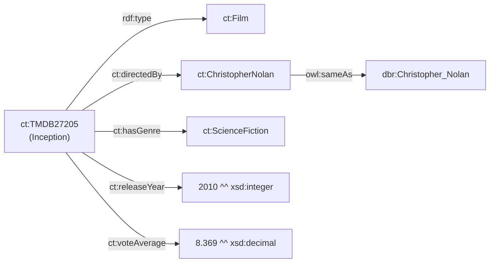
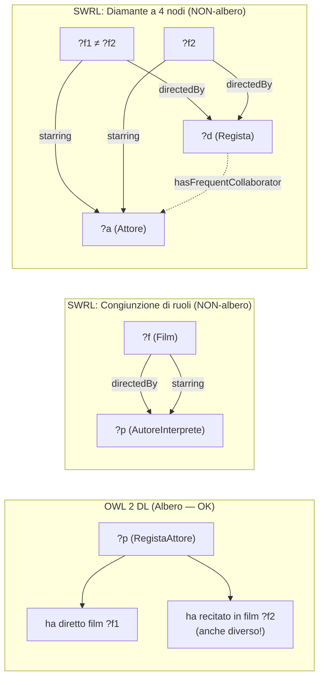

# Guida Completa all'Esame Orale di Semantic Web — Progetto CineTrope

> **A chi è rivolta questa guida**: a chi vuole preparare l'esame orale **partendo da zero**, senza dare per scontata nessuna nozione pregressa di Semantic Web, RDF, OWL, Logiche Descrittive, SPARQL, SWRL o Protégé.  
> **Come usarla**: leggila dall'inizio alla fine come una dispensa autonoma. Ogni argomento teorico del corso (Lezioni 1–12 della Prof.ssa Marianna Nicolosi Asmundo + Logiche Descrittive e SWRL) è spiegato prima con parole semplici e analogie quotidiane, poi con il lessico formale d'esame, e infine collegato direttamente al codice, all'ontologia e ai risultati reali di **CineTrope**.

---

## Indice dei Capitoli

- [Capitolo 0 — Partire da Zero: Cos'è il Semantic Web e Cos'è CineTrope](#capitolo-0--partire-da-zero-cosè-il-semantic-web-e-cosè-cinetrope)
- [Capitolo 1 — I Mattoni Base: RDF, URI, Triple, Formati e Named Graph](#capitolo-1--i-mattoni-base-rdf-uri-triple-formati-e-named-graph-lezioni-26)
- [Capitolo 2 — Le 4 Regole d'Oro del Semantic Web: AAA, Network Effect, OWA e No-UNA](#capitolo-2--le-4-regole-doro-del-semantic-web-aaa-network-effect-owa-e-no-una-lezioni-1-3)
- [Capitolo 3 — RDFS: Dare Significato ai Dati (e le 3 Trappole della Professoressa)](#capitolo-3--rdfs-dare-significato-ai-dati-e-le-3-trappole-della-professoressa-lezioni-910)
- [Capitolo 4 — OWL 2 DL e Logiche Descrittive ($\mathcal{SROIQ}(\mathcal{D})$) Senza Paura](#capitolo-4--owl-2-dl-e-logiche-descrittive-sroiqd-senza-paura-lezioni-1112--syllabus)
- [Capitolo 5 — Regole SWRL: Quando OWL 2 DL Non Basta Più](#capitolo-5--regole-swrl-quando-owl-2-dl-non-basta-più)
- [Capitolo 6 — Reasoning Automatico, HermiT e il Trade-off Espressività vs. Efficienza](#capitolo-6--reasoning-automatico-hermit-e-il-trade-off-espressività-vs-efficienza-lezione-2)
- [Capitolo 7 — SPARQL: Interrogare, Costruire e Federare Knowledge Graph](#capitolo-7--sparql-interrogare-costruire-e-federare-knowledge-graph-lezioni-78)
- [Capitolo 8 — Stack Tecnologico e Walkthrough del Codice Python (`build_ontology.ipynb`)](#capitolo-8--stack-tecnologico-e-walkthrough-del-codice-python-build_ontologyipynb)
- [Capitolo 9 — Copione dell'Orale, Demo Live in Protégé, 26 Domande Frequenti e Glossario A–Z](#capitolo-9--copione-dellorale-demo-live-in-protégé-26-domande-frequenti-e-glossario-az)

---

## Capitolo 0 — Partire da Zero: Cos'è il Semantic Web e Cos'è CineTrope

### 0.1 Il problema di partenza: perché il Web "normale" non basta alle macchine

Quando apri una pagina web su *Inception* (per esempio su Wikipedia), **tu** capisci immediatamente che:
- *Inception* è un film del 2010,
- *Christopher Nolan* è il suo regista,
- *Leonardo DiCaprio* è un attore che recita nel film,
- il film appartiene al genere *Fantascienza*.

Un computer, invece, vede soltanto **testo e tag HTML** (`<h1>Inception</h1>`, `<p>Diretto da Christopher Nolan...</p>`). I tag HTML dicono al browser *come disegnare* la pagina sullo schermo (titolo grande, paragrafo, grassetto), ma **non dicono cosa significano le parole**. Se una pagina contiene la parola `"Piano"`, un computer non sa se si riferisce a un aeroplano, a un pianoforte, a un piano di un edificio o a un progetto.

Il **Semantic Web** (ideato da Tim Berners-Lee, l'inventore del Web) nasce proprio per risolvere questo limite: affiancare al **Web dei documenti** (pensato per gli esseri umani) un **Web dei dati** (*Web of Data*), dove le informazioni sono espresse in un formato formale e condiviso che **anche le macchine possono comprendere, collegare tra loro e usare per ragionare**.

### 0.2 Database Relazionale (SQL) vs. Knowledge Base / Knowledge Graph

All'orale capita spessissimo che la docente chieda: *"Ma non potevi fare tutto questo con un normale database SQL?"*  
Ecco la differenza fondamentale (Lezione 2):

| Aspetto | Database Relazionale (SQL) | Knowledge Base / Knowledge Graph (Semantic Web) |
|---|---|---|
| **Struttura dei dati** | Tabelle rigide con righe e colonne | **Grafo orientato etichettato** di entità e relazioni |
| **Identificatori** | Chiavi primarie locali (`id = 42`, valide solo in quel DB) | **URI/IRI globali** (univoci su tutto il Web) |
| **Schema** | Separato dai dati (DDL: `CREATE TABLE`), rigido | **Ontologia** espressa nello stesso formato dei dati (RDF) |
| **Dati mancanti** | Ciò che non è nella tabella è considerato **falso** (*Closed World*) | Ciò che non è noto è semplicemente **ignoto** (*Open World*) |
| **Ragionamento** | Nessuna inferenza automatica (solo query sui fatti inseriti) | **Reasoner automatico** che deduce fatti impliciti da assiomi logici |
| **Integrazione di fonti** | Difficile (serve allineare tabelle e colonne a mano) | Naturale: due grafi che condividono URI si fondono automaticamente |

In breve: un database SQL ti permette di archiviare e filtrare ciò che hai scritto tu. Un **Knowledge Graph** basato su un'ontologia permette a un motore logico (**reasoner**) di **scoprire nuove informazioni implicite**, verificare se ci sono contraddizioni logiche e combinare facilmente dati provenienti da fonti diverse (nel nostro caso: **TMDB**, **Wikidata** e **DBpedia**).

### 0.3 Cos'è un'ontologia?

La definizione ufficiale che la professoressa sottolinea a Lezione 2 (di **Studer, Benjamins e Fensel**, 1998) va saputa **parola per parola** e capita fino in fondo:

> *"An ontology is a **formal**, **explicit** specification of a **shared conceptualization**."*  
> (*Un'ontologia è una specifica formale ed esplicita di una concettualizzazione condivisa.*)

Scomponiamo le 4 parole chiave:
1. **Concettualizzazione** *(Genesereth & Nilsson)*: è una coppia $(D, R)$ dove $D$ è il dominio di discorso (nel nostro caso il mondo del cinema: film, registi, attori, generi, tropi, premi...) e $R$ è l'insieme delle relazioni tra gli elementi del dominio (`directedBy`, `starring`, `hasGenre`, `sequelOf`...).
2. **Esplicita**: i concetti, le proprietà e i vincoli non restano nella testa di chi progetta, ma sono dichiarati apertamente con definizioni chiare.
3. **Formale**: scritta in un linguaggio basato sulla logica matematica (RDFS / OWL 2 DL), così che una macchina possa elaborarla e fare inferenze senza ambiguità.
4. **Condivisa**: esprime un vocabolario su cui una comunità può accordarsi (ecco perché allineiamo le nostre classi a standard pubblici come `schema.org`, `DBpedia`, `Wikidata` e `FOAF`).

### 0.4 Cos'è CineTrope e come funzionano insieme le sue tecnologie

**CineTrope** è un sistema di **raccomandazione cinematografica spiegabile** basato su un'ontologia **OWL 2 DL** costruita interamente via codice Python. A differenza di una "scatola nera" di machine learning che ti dice *"ti consiglio Il cavaliere oscuro al 92%"* senza spiegare perché, CineTrope ti consiglia film simili a *Inception* **mostrandoti il grafo delle prove** (tropi narrativi condivisi, stesso regista, stessi attori, stessi generi) e indicandoti **da quale fonte proviene ogni singola informazione**.

Ecco l'intera architettura tecnologica di CineTrope, dal dato grezzo fino a Protégé e all'interfaccia web:



**Il ruolo di ogni tecnologia in una frase**:
- **Python + Jupyter Notebook (`build_ontology.ipynb`)**: il "laboratorio riproducibile" che costruisce tutta l'ontologia programmaticamente (zero Turtle scritto a mano).
- **`rdflib`**: la libreria Python standard per creare, manipolare, serializzare e interrogare grafi RDF/OWL/SPARQL (è la stessa libreria usata in tutti gli esercizi di `teoria/pratica/`).
- **`SPARQLWrapper`**: client Python che invia query SPARQL via HTTP agli endpoint remoti di **Wikidata** e **DBpedia**, salvando poi i risultati in cache JSON locali (così la demo funziona anche senza rete).
- **`OWLReady2` + `HermiT` (su Java 21 locale in `.venv/jre`)**: ponte Python verso il reasoner **HermiT**, il motore logico completo per **OWL 2 DL** che verifica la consistenza, classifica gli individui nelle classi definite ed esegue le regole SWRL.
- **`owlrl`**: reasoner leggero in puro Python usato solo come **fallback** di emergenza nel backend qualora `inferred.ttl` mancasse e non ci fosse Java.
- **Protégé 5.6+**: l'editor grafico standard del mondo accademico per aprire `core.ttl` o `core.owl`, esplorare la tassonomia inferita da HermiT, vedere le 6 regole SWRL nella *SWRLTab* ed eseguire *DL Query*.
- **FastAPI (Python)** e **Next.js + vis.js (TypeScript/React)**: espongono lo store semantico (`store.trig`) come web app interattiva con ricerca per classi inferite, grafo visuale delle spiegazioni e pagina per eseguire in diretta le 15 Competency Questions.

---

## Capitolo 1 — I Mattoni Base: RDF, URI, Triple, Formati e Named Graph (Lezioni 2–6)

### 1.1 Cos'è RDF e cos'è una Tripla

**RDF** (*Resource Description Framework*) è il modello dati di base del Semantic Web. L'idea è sorprendentemente semplice: **qualsiasi fatto del mondo può essere spezzato in una frase minima composta da 3 elementi**, chiamata **tripla RDF**:

```
( Soggetto , Predicato , Oggetto )
```

- **Soggetto**: la risorsa di cui stiamo parlando (es. il film *Inception*).
- **Predicato**: la proprietà o relazione (es. *è diretto da*, *ha titolo*, *appartiene al genere*).
- **Oggetto**: il valore della proprietà, che può essere **un'altra risorsa** (es. *Christopher Nolan*) oppure un **dato semplice / letterale** (es. la stringa `"Inception"` o il numero `2010`).

Mettendo insieme tante triple che condividono soggetti e oggetti, si forma automaticamente un **grafo orientato ed etichettato** $G = (V, E)$, dove i nodi sono soggetti/oggetti e gli archi etichettati sono i predicati:



Perché RDF rappresenta i dati **"cella per cella"** (Lezione 2)? Perché se rappresenti ogni singolo fatto come tripla indipendente con identificatori globali, **chiunque sul Web può aggiungere un fatto nuovo su una risorsa esistente** senza dover modificare la tabella originale (principio AAA!).

### 1.2 URI, IRI, Namespace e CURIE (QName)

Se io scrivo `"Nolan"` e tu scrivi `"Nolan"`, il computer non sa se parliamo del regista *Christopher Nolan*, di suo fratello *Jonathan Nolan* o di un calciatore. Nel Semantic Web ogni risorsa (soggetto, predicato o risorsa oggetto) è identificata globalmente da un **URI** (*Uniform Resource Identifier*, o **IRI** nella versione internazionale che supporta caratteri Unicode).

- Un **URI** assomiglia a un URL (es. `http://example.org/cinetrope#TMDB27205`), ma **non deve per forza essere una pagina web cliccabile**: il suo scopo primario è essere un **codice identificativo univoco a livello mondiale**.
- Poiché scrivere URI lunghi ad ogni riga sarebbe illeggibile, usiamo i **Namespace** e i **CURIE** (*Compact URI*, spesso chiamati **QName**): dichiariamo un **prefisso** breve in cima al file e poi scriviamo `prefisso:nomeLocale`.

Nel nostro `data/ontology/core.ttl` trovi proprio questi prefissi standard:

```turtle
@prefix ct:      <http://example.org/cinetrope#> .          # Il nostro vocabolario CineTrope
@prefix rdf:     <http://www.w3.org/1999/02/22-rdf-syntax-ns#> .  # Vocabolario base RDF
@prefix rdfs:    <http://www.w3.org/2000/01/rdf-schema#> .        # Vocabolario RDF Schema
@prefix owl:     <http://www.w3.org/2002/07/owl#> .               # Vocabolario OWL 2
@prefix xsd:     <http://www.w3.org/2001/XMLSchema#> .            # Tipi di dato XML Schema
@prefix schema:  <http://schema.org/> .                           # Schema.org (standard Web)
@prefix dbo:     <http://dbpedia.org/ontology/> .                 # Ontologia di DBpedia
@prefix dbr:     <http://dbpedia.org/resource/> .                 # Risorse/entità di DBpedia
@prefix wd:      <http://www.wikidata.org/entity/> .              # Entità Wikidata (es. wd:Q102427)
@prefix wdt:     <http://www.wikidata.org/prop/direct/> .         # Proprietà Wikidata (es. wdt:P166)
@prefix foaf:    <http://xmlns.com/foaf/0.1/> .                   # Friend of a Friend (persone)
@prefix skos:    <http://www.w3.org/2004/02/skos/core#> .         # Tassonomie e thesauri
@prefix dcterms: <http://purl.org/dc/terms/> .                    # Metadati Dublin Core
@prefix swrl:    <http://www.w3.org/2003/11/swrl#> .              # Regole SWRL
@prefix swrla:   <http://swrl.stanford.edu/ontologies/3.3/swrla.owl#> . # Annotazioni Protégé SWRLTab
```

> **Dettaglio tecnico utile all'orale**: attenzione a **non mettere mai spazi** nei nomi locali degli URI (Lezione 3) — nel notebook usiamo la funzione `slugify()` per trasformare `"Christopher Nolan"` in `ct:ChristopherNolan`. Inoltre, in `rdflib 7.x` il prefisso `schema:` è pre-associato a `https://schema.org/`, quindi nel nostro codice usiamo `g.bind("schema", SCHEMA, override=True, replace=True)` per evitare che `rdflib` stampi il prefisso sporco `schema1:`!

### 1.3 Letterali tipizzati, tag lingua e la OWL 2 Datatype Map

Un **letterale** (che può comparire **solo in posizione di Oggetto**, mai come Soggetto o Predicato in RDF!) rappresenta un valore concreto. In RDF 1.1 (Lezione 4) ha 2 o 3 componenti:
1. La **forma lessicale** (es. `"148"` oppure `"Film acclamato"`),
2. L'**URI del datatype** (es. `xsd:integer`, `xsd:decimal`, `xsd:string`),
3. Un eventuale **tag di lingua** (es. `@it`, `@en`), ammesso solo con `rdf:langString`.

**Esempi reali da `core.ttl`**:
- `"Inception"@it` → stringa con tag lingua italiano (`rdfs:label`).
- `"148"^^xsd:integer` (in Turtle abbreviabile semplicemente come `148`) → numero intero per la durata in minuti (`ct:runtime`).
- `"8.369"^^xsd:decimal` → numero decimale esatto per il voto medio (`ct:voteAverage`).

> **Domanda trabocchetto tipica sull'ontologia CineTrope**: *"Perché `releaseYear` usa `xsd:integer` e `releaseDate`/`birthDate` usano `xsd:string` invece di `xsd:gYear` e `xsd:date`?"*  
> **Risposta**: Perché lo standard **OWL 2 Datatype Map** (implementato rigidamente da **HermiT**) **non include `xsd:date` né `xsd:gYear`** (include solo `xsd:dateTimeStamp` per le date). Usare `xsd:date` o `xsd:gYear` fa fallire HermiT con `UnsupportedDatatypeException`. Usando `xsd:integer` per gli anni (`releaseYear`, `birthYear`) possiamo invece fare confronti numerici precisi con le datatype restriction (es. `birthYear ≤ 1975` per `VeteranDirector`)!

### 1.4 Blank Node, Container (aperti) e Collection (chiuse)

Tre concetti chiave delle Lezioni 4–6 che compaiono **ovunque** nel nostro `core.ttl`:

1. **Blank Node (BNode)**: sono nodi **anonimi** (privi di URI globale). Dal punto di vista logico rappresentano una **quantificazione esistenziale** (*"esiste qualcosa tale che..."*).
   - Nell'esempio della professoressa (Lezione 4): *"Il Sonetto 74 fu ispirato da una donna sconosciuta vissuta in Inghilterra"* → usiamo un BNode per la donna senza nome, oppure un BNode per *"una persona che ha la casella email `mailto:jane@example.org`"* (evitando l'errore di confondere la persona con il suo indirizzo email!).
   - In **CineTrope**: ogni classe anonima OWL 2 (es. `[ a owl:Restriction ; owl:onProperty ct:partOfCollection ; owl:someValuesFrom ct:Collezione ]`) e ogni atomo SWRL è un **Blank Node** creato in Python con `BNode()`.
2. **RDF Container (`rdf:Bag`, `rdf:Seq`, `rdf:Alt`) — liste APERTE**: servono per raggruppare risorse (`Bag` non ordinato, `Seq` ordinato, `Alt` alternative), ma per la *Open World Assumption* **non possono mai essere chiusi** (chiunque sul Web potrebbe aggiungere un quarto membro `rdf:_4`).
3. **RDF Collection (`rdf:List`) — liste CHIUSE**: è una lista concatenata terminata esplicitamente da **`rdf:nil`** tramite `rdf:first` e `rdf:rest`. In Turtle si scrive comodamente tra parentesi tonde `( ct:AcclaimedFilm ct:Blockbuster )`.
   - **Perché è indispensabile in OWL 2 e SWRL?** Perché quando scriviamo un'intersezione `owl:intersectionOf ( ct:AcclaimedFilm ct:Blockbuster )`, una catena `owl:propertyChainAxiom ( ct:directedBy ct:directorOf )`, una disgiunzione `owl:AllDisjointClasses` o gli atomi di una regola SWRL (`swrl:AtomList`), il reasoner **deve essere sicuro al 100% che la lista sia finita**! Nel nostro notebook le costruiamo con `rdflib.collection.Collection(...)`.

### 1.5 I Formati di Serializzazione (Lezioni 5–6)

Lo stesso identico grafo RDF può essere salvato su disco in sintassi diverse (**serializzazioni**), tutte equivalenti dal punto di vista semantico:

| Formato | Estensione | Com'è fatto | Dove lo usa CineTrope |
|---|---|---|---|
| **N-Triples** | `.nt` | Una tripla per riga con URI completi `<...>`. Verbosissimo, facilissimo da parsare. | Spiegato a L5–6 come formato canonico elementare. |
| **Turtle** | `.ttl` | Compatto e leggibile: usa `@prefix`, `a` per `rdf:type`, `;` per condividere il soggetto, `,` per condividere soggetto+predicato, `[...]` per BNode, `(...)` per `rdf:List`. | **`data/ontology/core.ttl`** (14.916 triple) e **`data/generated/inferred.ttl`** (2.055 triple). |
| **RDF/XML** | `.owl` / `.rdf` | Formato XML storico del W3C, nativo di OWL API e Protégé (come `Frutta.owl` e `Researcher.rdf` a L12). | **`data/ontology/core.owl`** (esportato apposta per Protégé e caricato da OWLReady2). |
| **Notation3 (N3)** | `.n3` | Superset di Turtle storico usato spesso per serializzare regole. | **`data/ontology/core.swrl.n3`** (le 6 regole SWRL isolate). |
| **TriG** | `.trig` | Estensione di Turtle che supporta i **Named Graph** (`grafo { triple... }`). | **`data/generated/store.trig`** (16.971 triple divise per fonte). |
| **JSON-LD** | `.jsonld` | Linked Data in formato JSON (`@context`, `@id`, `@type`). | Spiegato a L5–6 per sviluppatori web. |

**Esempio reale di Turtle da `core.ttl` (come leggerlo all'orale)**:
```turtle
ct:TMDB27205 a ct:Film, owl:NamedIndividual ;     # "a" significa rdf:type; "," elenca 2 oggetti
    rdfs:label "Inception"@it ;                   # ";" mantiene lo stesso soggetto ct:TMDB27205
    ct:directedBy ct:ChristopherNolan ;
    ct:hasGenre ct:Action, ct:Adventure, ct:ScienceFiction ;
    ct:releaseYear 2010 ;
    ct:voteAverage 8.369 .                        # "." chiude il blocco del soggetto
```

### 1.6 Provenienza dei dati: Reificazione (`rdf:Statement`) vs. Named Graph (Lezioni 4–6)

Come fai a dire *"Secondo Wikidata, Parasite ha vinto l'Oscar"* oppure *"Secondo DBpedia, Christopher Nolan è nato nel 1970"*? Devi fare **un'asserzione su un'altra asserzione**! In teoria esistono due tecniche:

1. **Reificazione esplicita W3C (`rdf:Statement`)** (Lezione 4): crei un nodo che rappresenta la tripla intera usando 4 triple ausiliarie (`rdf:type rdf:Statement`, `rdf:subject`, `rdf:predicate`, `rdf:object`) e poi ci attacchi la fonte (`web:Wikipedia wr:says _:stmt`).
   - *Problema*: quadruplica il numero di triple e rende le query SPARQL contorte e pesanti.
2. **Named Graph e Quadruple `(S, P, O, G)`** (Lezioni 4–6): assegni un URI (un nome) a un intero sottografo RDF. Ogni fatto diventa una **quadrupla** `(Soggetto, Predicato, Oggetto, Grafo)`.

**Scelta architetturale di CineTrope**: usiamo i **Named Graph** in `data/generated/store.trig`! Il dataset è partizionato in **5 named graph di provenienza** (tutti dichiarati come istanze di `ct:Fonte`):
- **`ct:Ontology`** (1.225 triple): tutta la TBox (classi, proprietà, assiomi OWL 2, regole SWRL).
- **`ct:TMDB`** (13.555 triple): catalogo film, cast, registi, generi, tropi, paesi, lingue, studi, collezioni.
- **`ct:DBpedia`** (129 triple): `birthDate`, `birthYear` e link `owl:sameAs dbr:...` dei 43 registi arricchiti da DBpedia.
- **`ct:Wikidata`** (7 triple): premi Oscar (`hasAward`, `awardCode`) e link `owl:sameAs wd:...` di *Rocky* e *Parasite*.
- **`ct:Inferred`** (2.055 triple): tutte le nuove triple dedotte automaticamente dal reasoner **HermiT**.

Così, quando il sito mostra una spiegazione o risponde alla CQ4 (*"Da quale fonte proviene l'asserzione 'Inception usa dreams'?"*), basta interrogare `GRAPH ?source { ct:TMDB27205 ct:hasTrope ct:dreams }` senza nessuna reificazione!

---

## Capitolo 2 — Le 4 Regole d'Oro del Semantic Web: AAA, Network Effect, OWA e No-UNA (Lezioni 1, 3)

A Lezione 1 la professoressa introduce **4 principi fondamentali** che distinguono radicalmente il Semantic Web da qualsiasi database o programma tradizionale. Devi conoscerli benissimo perché spiegano il *perché* di quasi tutte le scelte fatte in `core.ttl`!

### 2.1 AAA Slogan e Network Effect

- **AAA Slogan** (*"Anyone can say Anything about Any topic"*): chiunque sul Web può pubblicare nuove triple su una risorsa già descritta da qualcun altro (es. TMDB descrive *Christopher Nolan* come regista, DBpedia aggiunge la sua data di nascita, Wikidata aggiunge i suoi premi).
- **Network Effect (Effetto Rete)**: più persone e sistemi riutilizzano gli stessi URI e gli stessi vocabolari condivisi (`schema:`, `dbo:`, `wd:`, `foaf:`), più il grafo globale diventa ricco e interconnesso.

### 2.2 Open World Assumption (OWA) — Il concetto più importante dell'esame!

- In un **database SQL** vale la **Closed World Assumption (CWA — Assunzione di Mondo Chiuso)**: tutto ciò che non è presente nella tabella è considerato **FALSO**. Se nella tabella `Premi` non compare il film X, SQL risponde *"X non ha vinto premi"*.
- Nel **Semantic Web** (proprio per il principio AAA: il Web è infinito e distribuito!) vale la **Open World Assumption (OWA — Assunzione di Mondo Aperto)**: l'assenza di un'informazione **NON significa che sia falsa**, significa solo che **non la conosciamo ancora** (qualcun altro potrebbe aggiungerla domani!).

#### Come CineTrope dimostra l'OWA **dal vivo** in Protégé (esempio killer per l'orale!)

Guarda la nostra classe definita **`ct:StandardLengthFilm`**:
$$
\text{StandardLengthFilm} \equiv \text{Film} \sqcap \neg \text{EpicFilm}
$$
dove $\text{EpicFilm} \equiv \text{Film} \sqcap \exists \text{runtime}.\text{xsd:integer}[\ge 150]$.

Cosa fa **HermiT** sui nostri 100 film?
1. **16 film** hanno `runtime ≥ 150` → HermiT li classifica come **`EpicFilm`**.
2. **83 film** hanno un `runtime` noto `< 150` (es. *Inception* ha `148`). Poiché `ct:runtime` è dichiarata **`owl:FunctionalProperty`** (un film può avere **al massimo una** durata!), se un film ha `runtime = 148`, **non può avere anche un altro `runtime ≥ 150`**. Quindi HermiT **dimostra matematicamente** che quel film appartiene a $\neg\text{EpicFilm}$ e lo classifica come **`StandardLengthFilm`**!
3. **1 film — *Insecta* (`ct:TMDB1757324`) — non ha il dato `runtime` in ABox** (`runtime = 0` nei dati grezzi, quindi non emettiamo la tripla). Sotto Mondo Chiuso verrebbe messo in `StandardLengthFilm`. Sotto **OWA**, invece, HermiT **NON lo classifica né in `EpicFilm` né in `StandardLengthFilm`**, perché la sua durata ignota potrebbe essere benissimo 180 minuti oppure 90 minuti!

`16 + 83 + 1 = 100`. Questa singola dimostrazione su *Insecta* fa vedere alla professoressa che hai capito l'OWA **e** il ruolo di `FunctionalProperty` + `owl:complementOf` a livello impeccabile!

### 2.3 Non-Unique Naming Assumption (No-UNA) — `owl:sameAs` e `owl:AllDifferent`

- In un database SQL due codici diversi (`id = 1` e `id = 2`) indicano **sempre** due oggetti distinti (*Unique Name Assumption*).
- Nel Semantic Web vale la **Non-Unique Naming Assumption (No-UNA)**: **due URI diversi possono riferirsi esattamente alla stessa entità reale** (es. `ct:ChristopherNolan` nel nostro grafo e `dbr:Christopher_Nolan` su DBpedia sono la stessa persona!).

Questo ha **due conseguenze opposte**, entrambe presenti in CineTrope:
1. **Per dire che due URI diversi sono la STESSA cosa** si usa **`owl:sameAs`** (Lezione 3, nota a mano della professoressa a slide 7!). In CineTrope abbiamo **47 collegamenti `owl:sameAs`**:
   - 43 registi locali collegati ai loro URI DBpedia (es. `ct:ChristopherNolan owl:sameAs dbr:Christopher_Nolan`),
   - 2 film Oscar collegati a Wikidata (`ct:TMDB1366 owl:sameAs wd:Q188652` *Rocky*, `ct:TMDB496243 owl:sameAs wd:Q61448040` *Parasite*),
   - `ct:OscarBestPicture owl:sameAs wd:Q102427`,
   - l'alias locale `ct:SciFi owl:sameAs ct:ScienceFiction`.
2. **Per dire che due URI diversi sono DAVVERO entità DISTINTE** si usa **`owl:AllDifferent`** (o `owl:differentFrom`).
   - **Esempio concreto in CineTrope**: `MultiGenreFilm` è definita come *"Film con almeno 3 generi distinti"* (`hasGenre min 3 Genere`). Se *Inception* ha `ct:Action`, `ct:Adventure`, `ct:ScienceFiction`, **senza `owl:AllDifferent` sui 17 generi HermiT non classificherebbe *Inception* come `MultiGenreFilm`!** Perché? Perché sotto No-UNA, HermiT penserebbe *"e se `Action` e `Adventure` fossero due nomi diversi dello stesso genere?"* Dichiarando `owl:AllDifferent` sui 17 generi canonici (tenendo fuori l'alias `ct:SciFi`, altrimenti `SciFi = ScienceFiction` e `SciFi ≠ ScienceFiction` creerebbero una contraddizione!), HermiT conta correttamente **61 `MultiGenreFilm`**!

---

## Capitolo 3 — RDFS: Dare Significato ai Dati (e le 3 Trappole della Professoressa) (Lezioni 9–10)

### 3.1 TBox vs. ABox

Ogni Knowledge Base si divide concettualmente in due livelli:
- **TBox (*Terminological Box*)**: definisce il **vocabolario e le regole generali del dominio** — cioè le **classi** (`Film`, `Regista`, `Genere`), le **proprietà** (`directedBy`, `runtime`) e le relazioni tra classi/proprietà (`Film rdfs:subClassOf OperaAudiovisiva`). È l'analogo potenziato dello schema di un DB.
- **ABox (*Assertional Box*)**: contiene i **fatti concreti sugli individui** (`ct:TMDB27205 a ct:Film`, `ct:TMDB27205 ct:directedBy ct:ChristopherNolan`).

Nel nostro progetto, `core.ttl` contiene sia la TBox sia l'ABox (così HermiT e Protégé ragionano su tutto insieme), mentre in `store.trig` la TBox è separata nel named graph `:Ontology`.

### 3.2 I 4 costrutti base di RDFS e le loro regole di inferenza

**RDFS** (*RDF Schema*) aggiunge sopra RDF i 4 mattoni per costruire gerarchie e propagare tipi automaticamente (che nelle Lezioni 9–10 la professoressa esprime tramite regole SPARQL `CONSTRUCT`):

1. **`rdfs:subClassOf`** (gerarchia di classi — transitiva):
   - Se `ct:Film rdfs:subClassOf ct:OperaAudiovisiva` e `ct:TMDB27205 a ct:Film` → si inferisce `ct:TMDB27205 a ct:OperaAudiovisiva`.
2. **`rdfs:subPropertyOf`** (gerarchia di proprietà — transitiva):
   - Se `ct:directedBy rdfs:subPropertyOf ct:hasContributor` e `ct:TMDB27205 ct:directedBy ct:ChristopherNolan` → si inferisce `ct:TMDB27205 ct:hasContributor ct:ChristopherNolan`.
   - È lo stesso pattern degli esercizi `Firm` (Lezione 9: `longTermContract ⊑ contractsTo ⊑ worksFor ⊑ member`) e `Library` (Lezione 11: `borrows`, `checkedOut`, `signedOut` ⊑ `hasPossession`).
3. **`rdfs:domain`** (tipo inferito del **Soggetto** di una proprietà):
   - Se `P rdfs:domain D` e `x P y` → si inferisce **`x a D`**.
   - Se una proprietà ha *più* `rdfs:domain` (`D1` e `D2`), il soggetto viene classificato nell'**intersezione** di entrambi (`x a D1` **E** `x a D2`).
4. **`rdfs:range`** (tipo inferito dell'**Oggetto** di una proprietà):
   - Se `P rdfs:range R` e `x P y` → si inferisce **`y a R`**.

### 3.3 Le 3 Trappole di Modellazione RDFS (Lezioni 9–10) e come CineTrope le padroneggia

La Prof.ssa Nicolosi Asmundo dedica gran parte delle Lezioni 9 e 10 a **3 concetti/trappole critici**. Citarli spontaneamente all'orale fa un'ottima impressione!

#### Trappola 1: `rdfs:domain` e `rdfs:range` NON sono vincoli di validazione! (Esempio *Navi*, L10)
Chi viene da SQL pensa che `directedBy rdfs:range Regista` serva a *rifiutare* un dato se per sbaglio metti una persona non dichiarata come `Regista`. **Sbagliato!** In RDFS `domain` e `range` non scartano mai i dati: **inferiscono nuovi tipi**. Nell'esempio *Navi* (Lezione 10), dichiarare `ship:hasCommander rdfs:range ship:Captain` serve a classificare automaticamente `Smith` e `Longo` come `Captain` (e per `subClassOf` anche come `Officer`), senza averlo mai scritto nei dati!

#### Trappola 2: La Contaminazione di Dominio (*Navi + Commessi Viaggiatori*, L10 `Navi6` → `NaviFinal`)
Nell'esempio della Lezione 10, un'ontologia ha `ship:nextDeparture` (domain `ship:InServiceVessel`) e un'altra ha `sales:nextDeparture` (domain `sales:SalesPerson`). Se le fondi mettendole uguali (`subPropertyOf` reciproco), succede un disastro: le navi (`QM2`) vengono inferite come *commessi viaggiatori* (`SalesPerson`) e il venditore `John` viene inferito come una *nave* (`InServiceVessel`)!
- **La correzione insegnata a lezione (`NaviFinal.py`)**: creare una **superproprietà neutra SENZA `rdfs:domain`** (`cal:nextDeparture`) e dichiarare entrambe le proprietà specifiche come sue `rdfs:subPropertyOf`.
- **Come l'abbiamo applicata in CineTrope**: abbiamo due classi **disgiunte**, `ct:Paese` (es. `Country_US`) e `ct:Lingua` (es. `Lang_en`), entrambe dotate di un codice ISO (`"US"`, `"en"`). Se avessimo messo `domain` su `ct:isoCode`, avremmo provocato un'inconsistenza! Seguendo esattamente `NaviFinal.py`, abbiamo dichiarato:
  - `ct:isoCode` **senza `rdfs:domain`** (superproprietà neutra),
  - `ct:countryIsoCode rdfs:subPropertyOf ct:isoCode ; rdfs:domain ct:Paese`,
  - `ct:languageIsoCode rdfs:subPropertyOf ct:isoCode ; rdfs:domain ct:Lingua`.
  Risultato: nessuna contaminazione di dominio, 0 inconsistenze, e 34 triple `ct:isoCode` inferite automaticamente da `subPropertyOf`!

#### Trappola 3: Il pattern `subPropertyOf rdfs:label` (*ActorsFilms*, L10) nel passaggio a OWL 2 DL
A Lezione 10 (`ActorsFilms.py`), per far sì che i browser RDF mostrino automaticamente nomi di persone e titoli di film, si dichiara `:movieTitle rdfs:subPropertyOf rdfs:label`.
- **Sfumatura avanzata per OWL 2 DL**: in RDFS puro è lecito, ma in **OWL 2 DL** le `owl:DatatypeProperty` (come `ct:title`) e le `owl:AnnotationProperty` (come `rdfs:label`) sono **categorie sintattiche disgiunte**. Se scrivessi `ct:title rdfs:subPropertyOf rdfs:label` con `ct:title a owl:DatatypeProperty`, violeresti OWL 2 DL!
- **Soluzione in CineTrope**: teniamo `ct:title` come `owl:DatatypeProperty` funzionale e aggiungiamo `ct:displayTitle a owl:AnnotationProperty ; rdfs:subPropertyOf rdfs:label`, rispettando sia il pattern della Lezione 10 sia la sintassi rigorosa di OWL 2 DL in Protégé!

### 3.4 I Limiti di RDFS (perché serve passare a OWL)

Come mostrato a Lezione 9 (*Hospital* e *AllStarCandidate*), RDFS può solo **approssimare** gli operatori insiemistici:
- **Intersezione incompleta**: scrivendo `Surgeon ⊑ Doctor` e `Surgeon ⊑ HospitalStaff`, se sai che Kildare è `Surgeon` deduci che è sia `Doctor` sia `HospitalStaff` ($C \subseteq A \cap B$). **Ma NON puoi fare il contrario**: se sai che X è sia `Doctor` sia `HospitalStaff`, RDFS non può mai inferire che X è `Surgeon`!
- **Unione aperta**: scrivendo `MVP ⊑ AllStarCandidate` e `TopScorer ⊑ AllStarCandidate` ($A \cup B \subseteq C$), non puoi escludere che esistano altri `AllStarCandidate` fuori da `MVP` e `TopScorer`.
- **Mancano completamente**: disgiunzione (`disjointWith`), negazione (`complementOf`), proprietà inverse (`inverseOf`), simmetriche, transitive, cardinalità, restrizioni numeriche e controllo di consistenza (`owl:Nothing`).

Per tutto questo si sale al gradino successivo: **OWL 2 DL**.

---

## Capitolo 4 — OWL 2 DL e Logiche Descrittive ($\mathcal{SROIQ}(\mathcal{D})$) Senza Paura (Lezioni 11–12 + Syllabus)

### 4.1 Cosa significa OWL 2 DL e cosa vuol dire $\mathcal{SROIQ}(\mathcal{D})$?

**OWL 2** (*Web Ontology Language*) è il linguaggio standard W3C per scrivere ontologie ricche. Ne esistono vari profili (Lezione 1, Syllabus):
- **OWL 2 EL** (ottimo per enormi tassonomie biomediche come SNOMED CT, tempo polinomiale),
- **OWL 2 QL** (ottimo per riscrittura su database SQL),
- **OWL 2 RL** (basato su regole, implementato da `owlrl`, veloce ma incompleto rispetto a negazioni/unioni/cardinalità),
- **OWL 2 DL** (*Description Logic*): il profilo più espressivo che resta ancora **decidibile** (cioè un reasoner come **HermiT** garantisce di terminare sempre con risposta corretta e completa).

Dietro le quinte, OWL 2 DL corrisponde esattamente alla **Logica Descrittiva** chiamata **$\mathcal{SROIQ}(\mathcal{D})$**. Sembra una sigla spaventosa, ma ogni lettera indica semplicemente un "ingrediente" logico che usiamo davvero in CineTrope:

| Lettera | Significato formale | Traduzione in parole semplici | Esempio reale in CineTrope |
|---|---|---|---|
| **$\mathcal{S}$** | $\mathcal{ALC}$ + ruoli transitivi | Operatori booleani ($\sqcap$ AND, $\sqcup$ OR, $\neg$ NOT), quantificatori ($\exists$ *esiste*, $\forall$ *per ogni*) + proprietà transitive | `NotableFilm` ($\sqcup$), `StandardLengthFilm` ($\neg$), `Film` ($\forall$), `sequelOf` / `subGenreOf` (transitive) |
| **$\mathcal{R}$** | Gerarchie di ruoli + catene di proprietà + ruoli asimmetrici/irriflessivi | `subPropertyOf`, `propertyChainAxiom`, `Asymmetric`, `Irreflexive` | `sameDirectorAs ← directedBy ∘ directorOf`, `hasAncestorGenre ← hasGenre ∘ subGenreOf`, `directSequelOf ⊑ sequelOf` |
| **$\mathcal{O}$** | Nominali (`owl:oneOf`, `owl:hasValue`) | Riferirsi a valori/individui specifici dentro una classe | `AwardedFilm` (`awardCode value "OSCAR_BEST_PICTURE"`) |
| **$\mathcal{I}$** | Proprietà inverse (`owl:inverseOf`) | Invertire la direzione di una freccia | `directedBy` ↔ `directorOf`, `starring` ↔ `actedIn`, `sequelOf` ↔ `hasSequel` |
| **$\mathcal{Q}$** | Cardinalità qualificate (`min/max/exact`) | Contare quanti elementi di un certo tipo sono collegati | `MultiGenreFilm` (`hasGenre min 3 Genere`) |
| **$(\mathcal{D})$** | Datatypes (`xsd:` + facet) | Restrizioni su numeri e stringhe (`≥`, `≤`, `<`, `>`) | `AcclaimedFilm` (`voteAverage ≥ 7.5`), `BoxOfficeFlop` (`0 < roi < 1.0`) |

### 4.2 Classi Primitive vs. Classi Definite (Fondamentale!)

Questa è una delle distinzioni più richieste all'esame:

- **Classe Primitiva (`rdfs:subClassOf` — condizione solo NECESSARIA)**:
  - Esempio: `ct:Film rdfs:subClassOf ct:OperaAudiovisiva` e `ct:Film rdfs:subClassOf (directedBy only Regista)`.
  - Significa: *"Se X è un Film, allora X è un'OperaAudiovisiva (e ogni suo regista è un Regista)"*.
  - Il reasoner **non** può classificare automaticamente un individuo dentro `Film` solo perché rispetta quelle condizioni: dobbiamo dichiarare esplicitamente `ct:TMDB27205 a ct:Film`.
- **Classe Definita (`owl:equivalentClass` — condizione NECESSARIA E SUFFICIENTE, $\equiv$)**:
  - Esempio: `ct:AcclaimedFilm ≡ ct:Film ⊓ (ct:voteAverage some xsd:decimal[≥ 7.5])`.
  - Significa: *"X è un AcclaimedFilm **se e solo se** è un Film e ha voto medio ≥ 7.5"*.
  - Grazie al "se e solo se", **non scriviamo mai `TMDB27205 a AcclaimedFilm` nell'ABox!** È il reasoner **HermiT** che guarda i dati di *Inception* (`voteAverage = 8.369 ≥ 7.5`) e **lo classifica automaticamente** dentro `AcclaimedFilm`!

> **Nota fine della Lezione 12 su `owl:equivalentClass`**: quando due classi nominate sono equivalenti (come `ct:Movie owl:equivalentClass ct:Film`, analogo a `Researcher ≡ Analyst` di L12), condividono **sempre esattamente le stesse istanze** (stessa estensione), ma **NON condividono le annotazioni** (`rdfs:label`, `rdfs:comment`), che restano indipendenti su ciascuna classe!

### 4.3 Le 16 Classi Definite di CineTrope (e i loro Costruttori OWL 2 DL)

Ecco tutte le **16 classi definite** in `core.ttl` con i numeri esatti classificati da HermiT sul nostro corpus top-100:

| # | Classe Definita | Costruttore OWL 2 DL | Definizione formale (Manchester / DL) | Istanze HermiT |
|---|---|---|---|---:|
| 1 | `AcclaimedFilm` | Datatype restriction (`xsd:minInclusive`) | `Film ⊓ (voteAverage some xsd:decimal[≥ 7.5])` | **48** |
| 2 | `Blockbuster` | Datatype restriction (`xsd:minInclusive`) | `Film ⊓ (revenue some xsd:integer[≥ 500 000 000])` | **17** |
| 3 | `EpicFilm` | Datatype restriction (`xsd:minInclusive`) | `Film ⊓ (runtime some xsd:integer[≥ 150])` | **16** |
| 4 | `EnsembleFilm` | Datatype restriction (`xsd:minInclusive`) | `Film ⊓ (castSize some xsd:integer[≥ 7])` | **97** |
| 5 | `ProfitableFilm` | Datatype restriction (`xsd:minInclusive`) | `Film ⊓ (roi some xsd:decimal[≥ 2.0])` *(disgiunta da `BoxOfficeFlop`)* | **41** |
| 6 | `BoxOfficeFlop` | Doppia datatype restriction (`minExclusive`+`maxExclusive`) | `Film ⊓ (budget ≥ 20M) ⊓ (roi > 0.0 ∧ roi < 1.0)` | **10** |
| 7 | `VeteranDirector` | Datatype restriction (`xsd:maxInclusive`, **DBpedia**) | `Regista ⊓ (birthYear some xsd:integer[≤ 1975])` | **29** |
| 8 | `CollectionFilm` | `owl:someValuesFrom` su classe nominata | `Film ⊓ (partOfCollection some Collezione)` | **24** |
| 9 | `Auteur` | `owl:someValuesFrom` su **classe definita** + inversa | `Regista ⊓ (directorOf some AcclaimedFilm)` | **64** |
| 10 | `MultiGenreFilm` | `owl:minQualifiedCardinality` + `AllDifferent` | `Film ⊓ (hasGenre min 3 Genere)` | **61** |
| 11 | `AwardedFilm` | `owl:hasValue` (**Wikidata**) | `Film ⊓ (awardCode value "OSCAR_BEST_PICTURE")` | **2** |
| 12 | `AcclaimedBlockbuster` | `owl:intersectionOf` di classi definite | `AcclaimedFilm ⊓ Blockbuster` | **16** |
| 13 | `RegistaAttore` | `owl:intersectionOf` di ruoli | `Regista ⊓ Attore` | **7** |
| 14 | `VeteranAuteur` | `owl:intersectionOf` cross-source (**TMDB + DBpedia**) | `Auteur ⊓ VeteranDirector` | **18** |
| 15 | `NotableFilm` | **`owl:unionOf`** di classi definite | `AcclaimedFilm ⊔ AwardedFilm ⊔ Blockbuster` | **49** |
| 16 | `StandardLengthFilm` | **`owl:complementOf`** + `FunctionalProperty` (**OWA**) | `Film ⊓ ¬EpicFilm` *(esclude *Insecta* senza runtime!)* | **83** |

A questi si aggiungono altri **3 assiomi strutturali TBox** fondamentali in Protégé:
- **Covering + Disgiunzione (`owl:disjointUnionOf`)**: `OperaAudiovisiva owl:disjointUnionOf ( Film SerieTV )` — dichiara contemporaneamente che ogni `OperaAudiovisiva` è *o* un `Film` *o* una `SerieTV`, e mai entrambi.
- **Partizione disgiunta (`owl:AllDisjointClasses`)**: le 10 classi radice (`OperaAudiovisiva`, `Persona`, `Genere`, `Tropo`, `Premio`, `Paese`, `Lingua`, `Studio`, `Collezione`, `Fonte`) sono a coppie disgiunte, più `ProfitableFilm owl:disjointWith BoxOfficeFlop`. Se per errore un individuo appartenesse a due classi disgiunte, HermiT lo segnalerebbe subito come **inconsistente (`owl:Nothing`)**!
- **Restrizioni universali (`owl:allValuesFrom`)**: su `Film` imponiamo `directedBy only Regista`, `hasGenre only Genere`, `originCountry only Paese`. *(Attenzione all'orale: perché non usiamo `allValuesFrom` per classificare film? Perché sotto OWA non puoi mai sapere se esistono altri archi `hasGenre` ignoti sul Web, a meno di aggiungere un "closure axiom" esplicito su ogni individuo! Usarlo come condizione necessaria `rdfs:subClassOf` invece è pulito e controlla la coerenza dei tipi.)*

### 4.4 Proprietà OWL 2, Property Chain e "Ruoli Semplici vs. Non Semplici"

In OWL 2 DL le proprietà si dividono in:
- **`owl:ObjectProperty`**: collegano due individui (es. `TMDB27205 directedBy ChristopherNolan`).
- **`owl:DatatypeProperty`**: collegano un individuo a un letterale (es. `TMDB27205 runtime 148`).
- **`owl:AnnotationProperty`**: metadati descrittivi ignorati dal ragionamento logico (es. `rdfs:label`, `rdfs:comment`, `dcterms:title`, `ct:displayTitle`, `skos:prefLabel`).

Ecco tutte le **caratteristiche algebriche** usate in `core.ttl` e cosa fa HermiT con ciascuna:
1. **`owl:inverseOf`** (Lezione 11, *Shakespeare* & *Library*): se `f directedBy d`, HermiT inferisce `d directorOf f` (**127** triple) e `a actedIn f` (**970** triple) e `c hasPart f` (**24** triple). Inoltre `hasContributor` ↔ `contributedTo` sono superproprietà inverse (esattamente come `hasPossession` ↔ `possessedBy` in `Library`!).
2. **`owl:SymmetricProperty`** (Lezione 11, *Shakespeare married*): se `a P b`, allora anche `b P a`. Usata su `coStarsWith` (**54** triple inverse inferite da HermiT!), `sameDirectorAs`, `sameCollectionAs`, `hasFrequentCollaborator`, `collaboratedWith`, `relatedFilm`.
3. **`owl:TransitiveProperty`**: se `a P b` e `b P c`, allora `a P c`. Usata su:
   - `ct:subGenreOf` (tassonomia dei generi),
   - `ct:sequelOf` e la sua inversa `ct:hasSequel`: in ABox asseriamo solo i salti diretti `Avengers: Doomsday → Avengers: Endgame` e `Avengers: Endgame → Avengers: Infinity War`, e **HermiT inferisce automaticamente `Avengers: Doomsday sequelOf Avengers: Infinity War`** (più tutte le inverse `hasSequel`)!
4. **`owl:FunctionalProperty`**: al massimo 1 valore per soggetto (`title`, `runtime`, `releaseYear`, `voteAverage`, `budget`, `revenue`, `roi`, `birthDate`, `birthYear`, `directSequelOf`...). È ciò che rende possibile la prova OWA di `StandardLengthFilm`!
5. **`owl:AsymmetricProperty` e `owl:IrreflexiveProperty`**: se `a P b` non può valere `b P a`, e non può valere `a P a`. Usate su `directedBy`, `starring` e **`directSequelOf`**.
   > **Domanda avanzata da 30 e lode**: *"Perché hai creato `directSequelOf` invece di mettere `Irreflexive` e `Asymmetric` direttamente su `sequelOf`?"*  
   > **Risposta**: Perché in OWL 2 DL vige la **restrizione sui ruoli semplici (*simple roles*)** per preservare la decidibilità! Una proprietà transitiva (o definita tramite property chain) è un **ruolo non semplice**, e la sintassi OWL 2 DL **vieta** di applicare `AsymmetricProperty`, `IrreflexiveProperty`, `FunctionalProperty` o cardinalità a ruoli non semplici. Separando `directSequelOf` (semplice: `Asymmetric + Irreflexive + Functional`) come `rdfs:subPropertyOf` di `sequelOf` (transitiva), otteniamo entrambi i benefici rispettando rigorosamente OWL 2 DL!
6. **`owl:propertyChainAxiom`** (composizione di proprietà $R \circ S \sqsubseteq T$):
   - **`sameDirectorAs`** ← `( directedBy , directorOf )`: se il film `f1` è diretto da `d`, e `d` ha diretto `f2`, allora `f1 sameDirectorAs f2` (**12 coppie = 24 triple** inferite senza scrivere join!).
   - **`hasAncestorGenre`** ← `( hasGenre , subGenreOf )`: se *Inception* ha genere `ScienceFiction`, e `ScienceFiction subGenreOf SpeculativeFiction`, allora HermiT inferisce `Inception hasAncestorGenre SpeculativeFiction` (**123 triple** inferite!).

### 4.5 Riuso e Allineamento di Vocabolari (`OntoComedySources`, Lezione 11–12)

Come nell'ontologia `OntoComedySources` vista a Lezione 11 (che riusa CIDOC CRM, Dublin Core, SPAR, Open Annotation, FOAF e SKOS), in CineTrope non reinventiamo il mondo isolati, ma:
- Usiamo **Dublin Core (`dcterms:`)** per i metadati dell'ontologia (`title`, `creator`, `description`, `created`) e **SKOS** (`skos:prefLabel`, `skos:altLabel`) sui generi e tropi.
- Dichiariamo allineamenti tipizzati OWL 2 DL tramite **`owl:equivalentClass`** (`ct:Film ≡ schema:Movie ≡ dbo:Film ≡ wd:Q11424`, `ct:Persona ≡ foaf:Person ≡ schema:Person ≡ dbo:Person`, `ct:Regista ≡ dbo:MovieDirector`, `ct:Attore ≡ dbo:Actor`...) e **`owl:equivalentProperty`** (`ct:directedBy ≡ schema:director ≡ dbo:director ≡ wdt:P57`, `ct:starring ≡ schema:actor ≡ dbo:starring ≡ wdt:P161`, `ct:hasAward ≡ wdt:P166`...).


---

## Capitolo 5 — Regole SWRL: Quando OWL 2 DL Non Basta Più

### 5.1 Che cos'è SWRL e cosa significa "DL-safe"?

**SWRL** (*Semantic Web Rule Language*) permette di aggiungere sopra OWL 2 DL delle **regole di Horn** della forma:

$$
\text{Antecedente (Body)} \longrightarrow \text{Conseguente (Head)}
$$

che si leggono intuitivamente come: **"SE tutte le condizioni a sinistra (Body) sono vere, ALLORA deduci le conseguenze a destra (Head)"**.

Tuttavia, combinare OWL 2 DL con regole SWRL arbitrarie rende il sistema **indecidibile** (il reasoner potrebbe non fermarsi mai!). Per mantenere la decidibilità in HermiT, le regole devono essere **DL-safe**:
- Ogni variabile che compare nella **testa (Head)** deve comparire anche nel **corpo (Body)**, e il reasoner applica le regole **solo agli individui nominati esplicitamente presenti nell'ABox** (non a individui anonimi immaginari generati dai quantificatori esistenziali).

### 5.2 Perché servono le regole SWRL? La *Tree-Model Property* spiegata con un disegno

Questa è una domanda di altissimo livello che mostra vera padronanza teorica: **"Se OWL 2 DL è già così espressivo, perché hai aggiunto regole SWRL?"**

La risposta sta nella **tree-model property** (*proprietà del modello ad albero*) delle Logiche Descrittive ($\mathcal{SROIQ}$): OWL 2 DL è bravissimo a esprimere proprietà che si diramano ad **albero** (da un film vai al regista, dal regista vai ai suoi film...), ma **NON può esprimere cicli arbitrari tra variabili** (come **congiunzioni di due ruoli paralleli**, **triangoli** o **diamanti a 4 nodi**)!



**Guarda il confronto killer da citare all'orale**:
- **`RegistaAttore`** (*puro OWL 2 DL*: `Regista ⊓ Attore`): classifica una persona che ha diretto *un* film e ha recitato in *un* film — **anche due film completamente diversi**!
- **`AutoreInterprete`** (*regola SWRL `SelfDirectedRoleRule`*): `Film(?f) ∧ directedBy(?f, ?p) ∧ starring(?f, ?p) → AutoreInterprete(?p)` — impone che i due archi `directedBy` e `starring` colleghino lo **STESSO film `?f`** e la **STESSA persona `?p`**! Questa è una **congiunzione di ruoli** (due frecce parallele che chiudono un ciclo), **dimostrabilmente impossibile in OWL 2 DL**!

### 5.3 Le 6 Regole SWRL di CineTrope (spiegate una per una)

In `core.ttl` e `core.swrl.n3` abbiamo **6 regole SWRL DL-safe**, tutte annotate con `swrla:isRuleEnabled true`, `rdfs:label` e `rdfs:comment` così da apparire pronte e leggibili nella **SWRLTab di Protégé**:

1. **`SelfDirectedRoleRule`** *(Congiunzione di ruoli — impossibile in OWL 2 DL)*:
   ```
   Film(?f) ∧ directedBy(?f, ?p) ∧ starring(?f, ?p) → AutoreInterprete(?p)
   ```
   - *Cosa scopre*: **7 persone** che hanno diretto e interpretato lo stesso film (es. Zach Cregger in *Resident Evil*, Nathan Fielder e Lance Oppenheim in *You Can See Everything*, Pierre Coffin in *Minions & Monsters*).

2. **`FrequentCollaboratorRule`** *(Ciclo a diamante a 4 nodi — impossibile in OWL 2 DL)*:
   ```
   Film(?f1) ∧ Film(?f2) ∧ differentFrom(?f1, ?f2)
   ∧ directedBy(?f1, ?d) ∧ directedBy(?f2, ?d)
   ∧ starring(?f1, ?a) ∧ starring(?f2, ?a)
   → hasFrequentCollaborator(?d, ?a)
   ```
   - *Cosa scopre*: **28 coppie** regista–attore che hanno lavorato insieme su **almeno 2 film distinti** (56 triple bidirezionali per simmetria), come **Christopher Nolan ↔ Michael Caine / Cillian Murphy / Anne Hathaway**, i fratelli Russo ↔ Robert Downey Jr. / Chris Evans / Chris Hemsworth, Takashi Yamazaki ↔ Ryunosuke Kamiki. Popola direttamente la **CQ6**!
   - *Nota OWA*: `differentFrom(?f1, ?f2)` funziona grazie all'`owl:AllDifferent` sui 13 film condivisi!

3. **`SequelDirectorRule`** *(Triangolo a 3 nodi sulla proprietà transitiva `sequelOf` — impossibile in OWL 2 DL)*:
   ```
   Film(?f1) ∧ Film(?f2) ∧ sequelOf(?f2, ?f1)
   ∧ directedBy(?f1, ?d) ∧ directedBy(?f2, ?d)
   → SequelDirector(?d)
   ```
   - *Cosa scopre*: **3 registi** che hanno diretto sia un film sia un suo sequel (*Anthony Russo*, *Joe Russo*, *Takashi Yamazaki*). Dimostra anche l'**interazione tra OWL 2 e SWRL**: la regola usa `sequelOf`, che è stata inferita da HermiT per transitività da `directSequelOf`!

4. **`VersatileAuteurRule`** *(Join multi-hop con doppia disuguaglianza + chaining OWL → SWRL)*:
   ```
   Regista(?d) ∧ directorOf(?d, ?f1) ∧ AcclaimedFilm(?f1) ∧ hasGenre(?f1, ?g1)
   ∧ directorOf(?d, ?f2) ∧ hasGenre(?f2, ?g2)
   ∧ differentFrom(?f1, ?f2) ∧ differentFrom(?g1, ?g2)
   → VersatileAuteur(?d)
   ```
   - *Cosa scopre*: **6 registi** che hanno diretto almeno un `AcclaimedFilm` e almeno due film distinti di generi distinti (es. Christopher Nolan, Anthony Russo, Joe Russo, Takashi Yamazaki...).

5. **`SharedCollectionRule`** *(Prevenzione dei self-loop tramite `DifferentIndividualsAtom`)*:
   ```
   Film(?f1) ∧ Film(?f2) ∧ differentFrom(?f1, ?f2)
   ∧ partOfCollection(?f1, ?c) ∧ partOfCollection(?f2, ?c)
   → sameCollectionAs(?f1, ?f2)
   ```
   - *Perché SWRL invece di una property chain `partOfCollection ∘ hasPart`?* Perché una property chain genera **anche** i self-loop riflessivi `Inception sameCollectionAs Inception`! Con `differentFrom(?f1, ?f2)` in SWRL, HermiT inferisce **solo coppie di film distinti** (4 coppie = 8 asserzioni simmetriche, zero self-loop!).

6. **`EnsembleAwardRule`** *(Chaining su 3 classi definite OWL 2 DL)*:
   ```
   Film(?f) ∧ EnsembleFilm(?f) ∧ AcclaimedFilm(?f) ∧ ProfitableFilm(?f) → PremioFilm(?f)
   ```
   - *Cosa scopre*: **29 film** che superano contemporaneamente tutte e tre le soglie (`castSize ≥ 7`, `voteAverage ≥ 7.5`, `roi ≥ 2.0`), mostrando come le regole SWRL consumino direttamente le classi inferite da OWL 2 DL.

### 5.4 Due domande intelligenti su SWRL da avere pronte all'orale

1. **"Perché non hai usato built-in aritmetici `swrlb:` (come `swrlb:greaterThan` o `swrlb:multiply`) dentro `core.ttl`?"**  
   *Risposta*: Perché **HermiT** (sia in OWLReady2 sia in Protégé) **non supporta gli atomi `swrl:BuiltinAtom`** e lancia `IllegalArgumentException: A SWRL rule uses a built-in atom, but built-in atoms are not supported yet`! Per questo abbiamo calcolato `roi = revenue/budget` e `birthYear` in Python e li abbiamo classificati con **OWL 2 Datatype Restrictions** (`ProfitableFilm`, `BoxOfficeFlop`, `VeteranDirector`), lasciando a SWRL i pattern grafici non ad albero che HermiT esegue nativamente senza errori.
2. **"E come popoli `coStarsWith` (CQ9)?"**  
   *Risposta*: In Cella 5 eseguiamo una query **SPARQL `CONSTRUCT`** (esattamente nello stile della **Lezione 8**) che materializza le **54** coppie di attori che hanno recitato insieme in ≥ 2 film **in una sola direzione** (`STR(?a1) < STR(?a2)`). Poi **HermiT** inferisce automaticamente le **54 direzioni inverse** grazie all'assioma `ct:coStarsWith a owl:SymmetricProperty` (esattamente nello stile della **Lezione 11 `ShakespeareSimm`**)!

---

## Capitolo 6 — Reasoning Automatico, HermiT e il Trade-off Espressività vs. Efficienza (Lezione 2)

### 6.1 Cosa fa concretamente un Reasoner?

Un **reasoner** (motore inferenziale) è un programma basato sulla logica formale che legge la TBox e l'ABox e deduce meccanicamente **tutte le conseguenze logiche implicite**. Svolge **4 compiti principali**:

1. **Controllo di Consistenza (*Consistency Checking*)**: verifica che non esistano contraddizioni logiche nell'ontologia (cioè che esista almeno un modello che soddisfa tutti gli assiomi) e che nessuna classe sia insoddisfacibile (equivalente a **`owl:Nothing`**). Nel nostro progetto: **0 classi inconsistenti, 0 individui `owl:Nothing`**.
2. **Classificazione (*Classification*)**: calcola la gerarchia completa tra classi (`subClassOf` implicite). Per esempio, anche se non l'avessimo scritto, HermiT deduce che `AcclaimedBlockbuster ⊑ AcclaimedFilm` e `AcclaimedBlockbuster ⊑ Blockbuster` e `AcclaimedBlockbuster ⊑ NotableFilm`.
3. **Realizzazione (*Realization*)**: assegna ogni individuo dell'ABox alle classi più specifiche a cui appartiene (es. *Inception* → `AcclaimedFilm`, `Blockbuster`, `AcclaimedBlockbuster`, `ProfitableFilm`, `StandardLengthFilm`, `MultiGenreFilm`, `EnsembleFilm`, `NotableFilm`, `PremioFilm`).
4. **Inferenza di proprietà (*Property Reasoning*)**: propaga `inverseOf`, `SymmetricProperty`, `TransitiveProperty`, `subPropertyOf`, `propertyChainAxiom` e teste di regole SWRL (`actedIn`, `directorOf`, `hasAncestorGenre`, `sequelOf`, `sameDirectorAs`, `hasFrequentCollaborator`, `coStarsWith`...).

### 6.2 I 3 livelli di Reasoning visti nel corso e nel progetto

| Approccio | Dove si usa | Come funziona | Pro e Contro |
|---|---|---|---|
| **Query SPARQL `CONSTRUCT` manuali** | Esercizi `teoria/pratica/` (L8–L12) | Scrivi a mano le regole di inferenza (`subClassOf`, `domain`, `inverseOf`...) e fai `g += qres`. | Didattico e trasparente, ma **incompleto**: non rileva contraddizioni, non gestisce cardinalità, negazioni o tableau. |
| **OWL 2 RL (`owlrl` in Python)** | Fallback di emergenza in `cinetrope/reasoning.py` | Forward-chaining basato sulle regole del profilo OWL 2 RL (tempo polinomiale). | Non richiede Java, ma **non supporta** `minQualifiedCardinality`, `complementOf`, datatype facet complesse. |
| **HermiT (OWL 2 DL completo)** | Motore principale in `build_ontology.ipynb` e in **Protégé** | Algoritmo **hypertableau** completo per $\mathcal{SROIQ}(\mathcal{D})$ + SWRL DL-safe (gira su JVM Java 21). | **Completo e sound**: gestisce tutti i costruttori OWL 2 DL, consistenza e SWRL. Costo computazionale più alto (worst-case `N2ExpTime`). |

> **Nota architetturale**: nel backend FastAPI **non eseguiamo HermiT ad ogni avvio del sito** (ci vorrebbero 2 minuti). Eseguiamo HermiT **una volta sola** nella pipeline (`build_ontology.ipynb`), salviamo le **2.055 triple inferite** in `data/generated/inferred.ttl`, e all'avvio il backend carica il dataset già materializzato (`store.trig`) in meno di 1 secondo!

### 6.3 Il nostro Caso Studio Reale sul Trade-off Espressività / Efficienza (Lezione 2, Slide 22)

A Lezione 2 la professoressa sottolinea il principio cardine della Rappresentazione della Conoscenza: **più un linguaggio è espressivo, più costa ragionarci sopra**. Nel nostro progetto lo abbiamo **misurato sperimentalmente** con veri benchmark di ablazione su HermiT:

1. **Primo collo di bottiglia (da 4.512s → 23.5s)**: applicare `owl:AllDifferent` su tutti i **909 attori** del corpus per una cardinalità qualificata creava $\binom{909}{2} \approx 412.000$ disuguaglianze a coppie nel tableau! Spostando `minQualifiedCardinality` sui **17 generi** (`MultiGenreFilm`: solo $\binom{17}{2} = 136$ coppie!) e usando `castSize ≥ 7` per `EnsembleFilm`, il tempo è crollato di **190 volte**.
2. **Secondo collo di bottiglia (da 607.6s → 141.3s in OWLReady2 / ~85s in Protégé — 4.2× speedup)**: nella v3.1 avevamo inizialmente inserito anche `owl:oneOf` (`SpeculativeSubGenre`), `owl:hasKey` sui 100 film, `AllDifferent` su tutti i 100 film e un'8ª regola SWRL a 4 variabili su 970 archi `starring`. I benchmark hanno mostrato un risultato classico della letteratura su HermiT (*Motik et al., JAIR 2009*): **anche un singolo assioma nominale (`owl:oneOf` / `owl:hasKey`) disattiva la modalità veloce *nominal-free* di HermiT**, attivando il *nominal merging* su tutti gli individui! Mantenendo la TBox **nominal-free**, restringendo `AllDifferent` ai soli **13 film** che condividono regista o franchise ($\binom{13}{2} = 78$ coppie anziché $4.950$) e calcolando `coStarsWith` via `CONSTRUCT` + `SymmetricProperty`, abbiamo ottenuto un'ontologia ricchissima che gira in ~85 secondi in Protégé con **0 inconsistenze**.

Raccontare questo risultato sperimentale all'orale dimostra **padronanza autentica** (non solo teorica!) della complessità delle Logiche Descrittive.

---

## Capitolo 7 — SPARQL: Interrogare, Costruire e Federare Knowledge Graph (Lezioni 7–8)

### 7.1 Come leggere una query SPARQL partendo da zero

**SPARQL** (*SPARQL Protocol and RDF Query Language*) sta al Semantic Web come SQL sta ai database relazionali, ma invece di unire tabelle fa **graph pattern matching**: tu scrivi un piccolo "pezzo di grafo" con dei buchi rappresentati da **variabili** che iniziano con `?` (es. `?film`, `?title`, `?director`), e il motore cerca tutti i modi in cui quel disegno si incastra dentro il Knowledge Graph!

Esempio elementare:
```sparql
PREFIX ct:   <http://example.org/cinetrope#>
PREFIX rdfs: <http://www.w3.org/2000/01/rdf-schema#>

SELECT ?title ?year
WHERE {
  ?film a ct:AcclaimedBlockbuster ;   # cerca ogni ?film classificato da HermiT
        rdfs:label ?title ;           # prendi il suo titolo leggibile
        ct:releaseYear ?year .        # prendi l'anno di uscita
  FILTER (?year >= 2010)              # tieni solo i film dal 2010 in poi
}
ORDER BY DESC(?year) ?title
```
Ricorda 3 regole sintattiche enfatizzate a Lezione 7:
- **Nomi descrittivi per le variabili**: sempre `?director`, `?film`, `?trope` (mai `?x1`, `?q0`).
- **Indipendenza dall'ordine delle triple** dentro il blocco `WHERE { ... }`.
- **`FILTER (...)` vuole le parentesi TONDE**, non graffe!

### 7.2 Le 4 Forme di Query SPARQL (tutte esercitate in CineTrope!)

| Forma | Cosa restituisce | Come la usa CineTrope |
|---|---|---|
| **`SELECT`** | Una **tabella** di righe e colonne (valori delle variabili) | Tutte le 15 Competency Questions, ricerca film, raccomandazioni (`03_recommendations.rq`), verifica in Cella 10. |
| **`CONSTRUCT`** | Un **nuovo grafo RDF** costruito sostituendo le variabili in un template | 1. **`04_explanation_construct.rq`**: genera il grafo di spiegazione vis.js di una raccomandazione.<br/>2. **Cella 5**: genera le 54 coppie unidirezionali `coStarsWith`.<br/>3. **Cella 10**: traduce `ct:TMDB27205` verso `schema:Movie` e `dbo:Film` (stile L8 `VCards`). |
| **`ASK`** | Un booleano **`True` / `False`** (esiste almeno un match?) | **Cella 10**: `ASK { ?x a owl:Nothing }` (`False` → consistente!), `ASK { ct:ChristopherNolan ct:hasFrequentCollaborator ct:MichaelCaine }` (`True`), `ASK { ct:TMDB1003596 ct:sequelOf ct:TMDB299536 }` (`True`). |
| **`DESCRIBE`** | Un grafo RDF con tutte le triple che descrivono una risorsa | **Cella 10**: `DESCRIBE ct:OscarBestPicture` (restituisce tipo, etichette `@it`/`@en`, commento, `owl:sameAs wd:Q102427`). |

### 7.3 Le Clausole SPARQL Chiave (Lezioni 7–8) e dove vederle nel progetto

- **`OPTIONAL { ... }`** (*left outer join* — fondamentale sotto OWA!): se chiedi `?film ct:releaseYear ?year` senza `OPTIONAL`, un film senza anno sparisce dai risultati; con `OPTIONAL` viene mantenuto con `?year` vuoto (`03_recommendations.rq`, `17_cq_auteur.rq`).
- **`FILTER NOT EXISTS { ... }`** (negazione): usata in Cella 10 per trovare *Insecta* (film che non è né `EpicFilm` né `StandardLengthFilm`) e nei controlli di validazione (`cinetrope/reasoning.py`: film senza regista o anno).
- **`UNION`**: combina rami alternativi (es. in `04_explanation_construct.rq` unisce tropi condivisi `UNION` registi condivisi `UNION` attori condivisi `UNION` generi condivisi).
- **`GROUP BY`, `HAVING`, `COUNT(DISTINCT ...)`**: aggregazioni usate in `03_recommendations.rq` (punteggio pesato delle raccomandazioni) e in **CQ1** (`10_cq_shared_two_tropes.rq`: `HAVING (COUNT(DISTINCT ?trope) >= 2)`).
- **`GRAPH ?source { ... }`**: interroga i **Named Graph** per sapere *quale fonte* asserisce una tripla (`05_provenance_assertion.rq`, `04_explanation_construct.rq`, `07_frequent_collaborators.rq`).
- **`SERVICE <https://dbpedia.org/sparql> { ... }`** (**query federata**, Lezione 8): spedisce una sottoquery direttamente a un endpoint SPARQL remoto (`data/queries/enrich_birthdates_service.rq`). Nel notebook usiamo anche `SPARQLWrapper` con `VALUES` a blocchi + cache JSON per garantire riproducibilità offline.
- **Property Paths (`+`)** (Lezioni 9–10, `TCQ.py` / `NaviQuery3.py`): `?sub ct:subGenreOf+ ?anc` percorre la gerarchia dei generi per 1 o più salti (Cella 10).
- **Query sui Metadati / Schema** (Lezione 7, slide 14–18): poiché RDFS e OWL sono essi stessi scritti in RDF, con SPARQL puoi interrogare la TBox stessa (`?c a owl:Class`, `?op a owl:ObjectProperty`, Cella 10).

### 7.4 Mappa Rapida delle 15 Competency Questions (tutte 15/15 verificate e non vuote!)

Le **Competency Questions (CQ)** sono le domande di dominio a cui l'ontologia deve saper rispondere fin dalla fase di progettazione. Nel sito (`/queries`) sono eseguibili in diretta:

| ID | Tema | Cosa dimostra dal punto di vista Semantic Web | Righe |
|---|---|---|---:|
| **CQ1** | Tropi condivisi con *Avengers: Endgame* | `GROUP BY`, `HAVING (COUNT(DISTINCT ?trope) >= 2)` | 6 |
| **CQ2** | Regista e tropo condiviso | Join multi-tripla `directedBy` + `hasTrope` | 18 |
| **CQ3** | Dettagli condivisi (*Inception* vs *Il cavaliere oscuro*) | `UNION` + `GRAPH ?source` (provenienza) | 4 |
| **CQ4** | Provenienza di *"Inception usa dreams"* | `GRAPH ?source` sui Named Graph senza reificazione | 1 |
| **CQ5** | Raccomandazioni spiegabili per *Inception* | Sottoquery `OPTIONAL` + `COALESCE` + score pesato | 5 |
| **CQ6** | Collaboratori frequenti (`hasFrequentCollaborator`) | **Regola SWRL a diamante `FrequentCollaboratorRule`** | 28 |
| **CQ7** | Gerarchia dei generi (`subGenreOf`) | Generi modellati come individui con proprietà transitiva | 11 |
| **CQ8** | Statistiche per fonte | Conteggio triple per ciascun Named Graph | 5 |
| **CQ9** | Co-star ricorrenti (`coStarsWith`) | **SPARQL `CONSTRUCT` (L8) + `owl:SymmetricProperty` (L11)** | 30 |
| **CQ10** | `AcclaimedBlockbuster` | **Intersezione di classi definite** (`AcclaimedFilm ⊓ Blockbuster`) | 16 |
| **CQ11** | Narrativa speculativa (`hasAncestorGenre`) | **Property chain `hasGenre ∘ subGenreOf`** | 30 |
| **CQ12** | Stesso regista (`sameDirectorAs`) | **Property chain `directedBy ∘ directorOf`** | 15 |
| **CQ13** | Registi `Auteur` | **`someValuesFrom` su classe definita + inversa `directorOf`** | 30 |
| **CQ14** | `MultiGenreFilm` | **`minQualifiedCardinality` (`min 3 Genere`) + `AllDifferent`** | 30 |
| **CQ15** | `AcclaimedFilm` e `Blockbuster` | **Datatype restriction OWL 2 (`xsd:minInclusive`)** | 30 |

---

## Capitolo 8 — Stack Tecnologico e Walkthrough del Codice Python (`build_ontology.ipynb`)

La professoressa guarderà molto attentamente il **codice Python** che produce l'ontologia ([notebooks/build_ontology.ipynb](file:///c:/uni/CineTrope/notebooks/build_ontology.ipynb)). Ecco cosa fa ogni singola cella, così se la scorre insieme a te sai spiegare ogni blocco senza esitazioni:

### 8.1 Come `rdflib` costruisce un assioma OWL 2 in Python (senza scrivere Turtle a mano)

Un dubbio classico di chi legge il Python per la prima volta è: *"Come fa `rdflib` a creare una classe definita OWL 2?"*  
Ricorda: **in OWL 2 ogni espressione complessa è fatta di normali triple RDF + Blank Node + `rdf:List`!** Nel notebook abbiamo scritto 9 piccole funzioni helper in **Cella 2**:
- `add_class(...)`: aggiunge `(uri, RDF.type, OWL.Class)`, `rdfs:label` in `@it` e `@en`, `rdfs:comment`, eventuale `rdfs:subClassOf` e `owl:disjointWith`.
- `owl_restriction(prop, restr_type, val)`: crea un `BNode()` di tipo `owl:Restriction`, attacca `owl:onProperty` e la restrizione (`owl:someValuesFrom`, `owl:allValuesFrom`, `owl:hasValue`).
- `owl_datatype_restriction(dt, facets)`: crea un `BNode()` di tipo `rdfs:Datatype` con `owl:onDatatype` (es. `XSD.decimal`) e una `Collection` (`rdf:List`) di `owl:withRestrictions` (es. `xsd:minInclusive 7.5`).
- `owl_intersection(*nodes)` / `owl_union(*nodes)`: creano un `BNode()` di tipo `owl:Class` con una `Collection` attaccata a `owl:intersectionOf` / `owl:unionOf`.
- `owl_complement(node)`: crea un `BNode()` con `owl:complementOf`.
- `add_min_qualified_cardinality(prop, n, cls)`: crea un `owl:Restriction` con `owl:minQualifiedCardinality` (`xsd:nonNegativeInteger`) e `owl:onClass`.
- `add_defined_class(...)`: collega la classe nominata all'espressione anonima tramite **`OWL.equivalentClass`**.

### 8.2 Walkthrough Cella per Cella di `build_ontology.ipynb`

| Cella | Cosa fa il codice Python | Dettaglio chiave da raccontare alla docente |
|---|---|---|
| **Cella 0** | Import, rilevamento `ROOT`, definizione path e `Namespace` (`CT`, `SCHEMA`, `DBO`, `DBR`, `WD`, `WDT`, `FOAF`, `SKOS`, `SWRL`, `SWRLA`, `DCTERMS`). | Prefissi puliti con `override=True, replace=True` (niente `schema1:`). |
| **Cella 1** | Legge `data/raw/films.json` (500 film) e seleziona i **top-100** per popolarità TMDB. | Scelta motivata: 100 film (~1.019 persone, 879 tropi) sono abbastanza ricchi per pattern reali ma gestibili in Protégé e HermiT. |
| **Cella 2** | Metadati ontologia (`dcterms:*`), `ct:displayTitle` (`AnnotationProperty ⊑ rdfs:label`), helper OWL 2, 14 classi primitive, `OperaAudiovisiva owl:disjointUnionOf (Film SerieTV)`, `AllDisjointClasses` sulle 10 radici, alias `Movie ≡ Film`. | Tutto costruito programmaticamente via `rdflib` (zero Turtle scritto a mano). |
| **Cella 2b** | 31 `ObjectProperty`: superproprietà inverse (`hasContributor`/`contributedTo`), `directSequelOf` (semplice: `Asymmetric+Irreflexive+Functional`) ⊑ `sequelOf` (`Transitive`), `propertyChainAxiom` (`sameDirectorAs`, `hasAncestorGenre`), `allValuesFrom` su `Film`. | Separazione rigorosa ruoli semplici vs non semplici in OWL 2 DL. |
| **Cella 2c** | 24 `DatatypeProperty` funzionali + pattern L10 `NaviFinal`: `countryIsoCode` e `languageIsoCode` sottoproprietà della superproprietà neutra `isoCode`. | Evita la contaminazione di dominio tra `Paese` e `Lingua`. |
| **Cella 2d** | Le **16 classi definite** (`AcclaimedFilm`... `StandardLengthFilm`, `NotableFilm`, `VeteranAuteur`, `RegistaAttore`, `MultiGenreFilm`, `AwardedFilm`...) + `ProfitableFilm disjointWith BoxOfficeFlop`. | Copre tutti i costruttori *nominal-free* di $\mathcal{SROIQ}(\mathcal{D})$. |
| **Cella 2e** | Allineamenti tipizzati OWL 2 DL (`equivalentClass` / `equivalentProperty`) verso `schema.org`, `dbo:`, `wd:`, `wdt:`, `foaf:`. | Ogni termine esterno è dichiarato esplicitamente come `owl:Class` / `ObjectProperty` / `DatatypeProperty` per evitare violazioni di sintassi OWL 2 DL. |
| **Cella 3** | Query SPARQL remota su **Wikidata** (`SPARQLWrapper`, `wdt:P345` + `wdt:P166 wd:Q102427`) → 2 vincitori Oscar (*Rocky*, *Parasite*) + URI `wd:Q...`, salvati in `wikidata_oscar_cache.json`. | Fallback automatico su cache locale se la rete non è disponibile. |
| **Cella 4** | Query SPARQL a blocchi (`VALUES`, blocchi da 25) su **DBpedia** (`dbo:birthDate`) → **43/117** registi con data di nascita e URI `dbr:...`, salvati in `dbpedia_directors_cache.json`. | I blocchi da 25 evitano errori HTTP 500 del server Virtuoso di DBpedia. |
| **Cella 5** | Popolamento ABox: tutti gli individui tipizzati **`owl:NamedIndividual`**, `roi`, `birthYear`, `Lingua`/`originalLanguage`, `directSequelOf` (*Avengers* e *Godzilla*), 47 `owl:sameAs`, `AllDifferent` sui 17 generi + 13 film condivisi, più **SPARQL `CONSTRUCT` L8** per le 54 coppie unidirezionali `coStarsWith`. | Totale ABox + TBox: 14.597 triple prima di SWRL. |
| **Cella 6** | Aggiunta programmatica delle **6 regole SWRL DL-safe** (`_add_atom_list` costruisce `swrl:AtomList` + `swrl:Variable` tipizzate + annotazioni `swrla:isRuleEnabled`). | Totale `core.ttl`: **14.916 triple**. |
| **Cella 7** | Serializzazione in 3 formati: `core.ttl` (Turtle), `core.owl` (RDF/XML nativo Protégé), `core.swrl.n3` (N3). | `core.owl` è caricato direttamente da OWLReady2 (che non parsa nativamente Turtle) e apribile in Protégé. |
| **Cella 8** | Avvio di **HermiT** via `owlready2.sync_reasoner_hermit(world, infer_property_values=True)` usando la JRE 21 locale in `.venv/jre` e `load(fileobj=fh)` (aggira il bug URI Windows `file:///C:/...`). | Completato in `141.3s`, **0 classi inconsistenti**. |
| **Cella 9 & 9b** | Estrae le **2.055 triple inferite** in `data/generated/inferred.ttl` e chiama `CineTropeStore.rebuild()` (`cinetrope/etl.py`) che partiziona `core.ttl` + `inferred.ttl` nei 5 named graph di `data/generated/store.trig` (**16.971 triple**) e genera `build_report.json`. | Il backend FastAPI legge `store.trig` in < 1s senza mai rilanciare HermiT né chiamare la rete a runtime. |
| **Cella 10 & 11** | Verifica SPARQL completa (`SELECT`, prova OWA *Insecta*, `sequelOf`, `subGenreOf+`, diamanti SWRL, 3 `ASK`, `CONSTRUCT` `schema.org`, `DESCRIBE`, metadata query TBox) + riepilogo finale. | Conferma 100% di consistenza e completezza. |

### 8.3 Gli altri moduli Python del progetto (in 30 secondi)

- **`scripts/pipeline.py`**: orchestratore da riga di comando (`pipeline.py core`, `validate`, `store`, `all`). Il comando **`validate`** esegue 7 controlli statici sulla TBox di `core.ttl` (etichette `@it`/`@en`, commenti sulle classi definite, `domain`/`range`, reciprocità delle inverse, riferimenti pendenti, assenza di cicli `subClassOf`): **7/7 `OK`**.
- **`cinetrope/etl.py`**: `build_from_core()` legge `core.ttl` come unica sorgente di verità e distribuisce le triple nei 5 named graph (`:Ontology`, `:TMDB`, `:Wikidata`, `:DBpedia`, `:Inferred`).
- **`cinetrope/reasoning.py` e `cinetrope/swrl.py`**: caricano le inferenze precalcolate di HermiT da `inferred.ttl`; se mancasse, eseguono il fallback `owlrl` + motore SWRL Python (che supporta anche `DifferentIndividualsAtom`).
- **`cinetrope/store.py` e `cinetrope/web.py`**: espongono le API FastAPI (`/api/home`, `/api/search`, `/api/film/{id}`, `/api/explanation/{seed}/{rec}`, `/api/queries/{id}`, `/api/sources`) consumate dal frontend Next.js (`web/`).

---

## Capitolo 9 — Copione dell'Orale, Demo Live in Protégé, 26 Domande Frequenti e Glossario A–Z

### 9.1 Copione consigliato per iniziare la presentazione (2–3 minuti)

> *"Buongiorno professoressa. Il mio progetto si chiama **CineTrope** ed è un sistema di raccomandazione cinematografica spiegabile basato su un'ontologia **OWL 2 DL** ($\mathcal{SROIQ}(\mathcal{D})$) costruita interamente in Python con **`rdflib`** — senza file Turtle scritti a mano — a partire da un corpus ristretto dei 100 film più popolari su TMDB, arricchito via SPARQL da **Wikidata** (premi Oscar Best Picture) e **DBpedia** (date di nascita dei registi).*
>
> *Ho strutturato la pipeline in un notebook riproducibile (`build_ontology.ipynb`) che genera sia `core.ttl` in Turtle sia `core.owl` in RDF/XML per Protégé, esegue il reasoning completo con **HermiT via OWLReady2** verificando 0 inconsistenze, materializza le 2.055 triple inferite in `inferred.ttl` e popola uno store a **5 Named Graph** (`store.trig`) per tracciare la provenienza di ogni asserzione senza ricorrere alla reificazione esplicita.*
>
> *Nell'ontologia ho voluto coprire sistematicamente sia i pattern RDFS/OWL visti a lezione — come la prevenzione della contaminazione di dominio su `isoCode`, i ponti `owl:sameAs` verso DBpedia e Wikidata e la dimostrazione live dell'Open World Assumption su `StandardLengthFilm` — sia il confine espressivo tra OWL 2 DL e **6 regole SWRL DL-safe** non esprimibili in $\mathcal{SROIQ}$, come la congiunzione di ruoli (`AutoreInterprete`) e il diamante a 4 nodi (`FrequentCollaboratorRule`). Se vuole, le mostro subito la pipeline Python e poi l'ontologia aperta in Protégé con HermiT attivo."*

### 9.2 Demo Live in Protégé 5.6+ (cosa cliccare e cosa commentare)

1. **`File → Open...` → `data/ontology/core.ttl`** (oppure `core.owl`).
   - Mostra la scheda **Active Ontology**: metadati Dublin Core (`dcterms:*`), versione `3.1.0`, **14.916 triple**, prefissi puliti (`schema:`, `dbo:`, `dbr:`, `wd:`, `wdt:`, `foaf:`, `skos:`).
2. **`Reasoner → HermiT` → `Reasoner → Start reasoner`** (~85s).
   - Fai notare subito: **0 errori, nessuna classe rossa sotto `owl:Nothing`**.
3. **Tab `Entities → Classes` (seleziona *Inferred* nel menu a tendina)**:
   - Apri `Film`: fai vedere `AcclaimedBlockbuster` inferito sotto sia `AcclaimedFilm` sia `Blockbuster`; `ProfitableFilm` disgiunta da `BoxOfficeFlop`; `NotableFilm` (`owl:unionOf`); `MultiGenreFilm` (`hasGenre min 3 Genere`, 61 film).
   - **Momento "wow" sull'OWA**: clicca `EpicFilm` (16 film) e `StandardLengthFilm` (83 film), poi spiega che *Insecta* (`TMDB1757324`), privo di `runtime`, **non compare in nessuna delle due** per l'Open World Assumption!
   - Apri `Persona`: mostra il confronto **`RegistaAttore`** (`Regista ⊓ Attore`, OWL 2 DL) vs **`AutoreInterprete`** (`SelfDirectedRoleRule`, SWRL), e **`VeteranAuteur`** (intersezione cross-source TMDB + DBpedia, 18 registi!).
4. **Tab `Entities → Object Properties` e `Individuals`**:
   - Mostra `directSequelOf ⊑ sequelOf` (`TransitiveProperty`): cerca `TMDB1003596` (*Avengers: Doomsday*) negli Individuals → nelle *Object property assertions (inferred)* in giallo compare **`sequelOf TMDB299536` (*Avengers: Infinity War*)** per transitività!
   - Cerca `ChristopherNolan` negli Individuals → mostra **`owl:sameAs dbr:Christopher_Nolan`**, `Auteur`, `VeteranAuteur`, `VersatileAuteur`, e **`hasFrequentCollaborator`** con `MichaelCaine`, `CillianMurphy`, `AnneHathaway` (diamante SWRL!).
5. **Tab `Entities → Data Properties`**:
   - Mostra `countryIsoCode` e `languageIsoCode` sotto `isoCode` → spiega il pattern **`NaviFinal`** della Lezione 10 (nessuna contaminazione di dominio tra `Paese` e `Lingua`).
6. **Tab `Window → Tabs → SWRLTab`**:
   - Fai vedere tutte e **6 le regole SWRL** abilitate con nome e descrizione in italiano.
7. **Tab `DL Query`** (spunta *Instances*):
   - Scrivi `Film and (not EpicFilm)` → `83` istanze (prova OWA in diretta!).
   - Scrivi `Regista and (directorOf some AcclaimedBlockbuster)` → mostra i registi dei blockbuster acclamati!

---

### 9.3 Banca di 26 Domande Frequenti all'Orale (con Risposta Pronta)

#### A. Teoria Fondamentale (Lezioni 1–12 & Logiche Descrittive)

1. **Cos'è un'ontologia e qual è la sua definizione formale?**  
   Per Studer, Benjamins e Fensel è *"una specifica formale ed esplicita di una concettualizzazione condivisa"*. Una concettualizzazione (Genesereth & Nilsson) è la coppia $(D, R)$ formata dal dominio di discorso $D$ e dalle relazioni $R$ su di esso.
2. **Che differenza c'è tra RDF, RDFS e OWL?**  
   **RDF** fornisce il modello a grafo basato su triple `(S, P, O)` e URI. **RDFS** aggiunge un vocabolario di base per gerarchie di classi (`subClassOf`), gerarchie di proprietà (`subPropertyOf`) e `domain`/`range`. **OWL 2 DL** aggiunge l'espressività della logica descrittiva $\mathcal{SROIQ}(\mathcal{D})$: classi definite (`equivalentClass`), operatori booleani ($\sqcap, \sqcup, \neg$), disgiunzioni, cardinalità qualificate, proprietà inverse/simmetriche/transitive/funzionali, property chain, datatype restriction e controllo di consistenza.
3. **Che cos'è la Open World Assumption (OWA) e in cosa differisce da un DB SQL?**  
   In SQL vale la *Closed World Assumption*: ciò che non è nel DB è falso. Nel Semantic Web (per l'AAA slogan) vale l'OWA: ciò che non è asserito è semplicemente *ignoto*, mai falso. In CineTrope lo dimostriamo con `StandardLengthFilm ≡ Film ⊓ ¬EpicFilm`: il film *Insecta* (senza `runtime`) non viene classificato né come `EpicFilm` né come `StandardLengthFilm`.
4. **Che cos'è la Non-Unique Naming Assumption (No-UNA)?**  
   Due URI diversi possono riferirsi alla stessa entità del mondo reale (a differenza delle chiavi primarie SQL). Per unificare due URI usiamo `owl:sameAs` (47 ponti verso DBpedia/Wikidata + `SciFi ≡ ScienceFiction`); per affermare che sono distinti usiamo `owl:AllDifferent` (indispensabile per `MultiGenreFilm` con `minQualifiedCardinality 3`).
5. **Che differenza c'è tra un RDF Container (`rdf:Bag`/`Seq`/`Alt`) e una RDF Collection (`rdf:List`)?**  
   I Container sono **aperti** (sotto OWA chiunque può aggiungere `rdf:_4`, quindi non puoi mai dire "questi sono *tutti* i membri"). Le Collection (`rdf:List` con `rdf:first`, `rdf:rest`, `rdf:nil`) sono **chiuse** e finite: per questo OWL 2 le richiede in `intersectionOf`, `unionOf`, `AllDisjointClasses`, `propertyChainAxiom` e `swrl:AtomList`.
6. **Cos'è un Blank Node e qual è il suo significato logico?**  
   Un nodo anonimo privo di URI globale. Logicamente rappresenta una **quantificazione esistenziale** ($\exists x$). In CineTrope i Blank Node rappresentano le espressioni anonime OWL 2 (`owl:Restriction`, `rdfs:Datatype`, classi anonime) e gli atomi delle regole SWRL.
7. **Come si rappresenta la provenienza (chi dice cosa) in RDF? Perché hai scelto i Named Graph invece di `rdf:Statement`?**  
   La reificazione esplicita W3C (`rdf:Statement` + `rdf:subject`/`predicate`/`object`) moltiplica per 4 le triple e complica le query SPARQL. I **Named Graph** estendono le triple in quadruple `(S, P, O, G)` in modo pulito e nativo (`store.trig`), permettendo di interrogare direttamente la fonte con `GRAPH ?source { ... }` (CQ3, CQ4, CQ8).
8. **Qual è il vero ruolo di `rdfs:domain` e `rdfs:range`? Validano i dati?**  
   **No!** Non sono vincoli di validazione come in SQL: sono **regole di inferenza** che deducono il tipo (`rdf:type`) del soggetto (`domain`) e dell'oggetto (`range`). Inoltre, più `domain` sulla stessa proprietà hanno semantica di **intersezione** (congiunzione).
9. **Cos'è il problema della contaminazione di dominio (Lezione 10 `Navi`) e come si risolve?**  
   Se si equiparano due proprietà di ontologie diverse con domini incompatibili (`ship:nextDeparture` e `sales:nextDeparture`), il reasoner inferisce che le navi sono commessi viaggiatori e viceversa. Si risolve introducendo una **superproprietà neutra priva di `rdfs:domain`** (`cal:nextDeparture`). In CineTrope applichiamo esattamente questo pattern su `ct:isoCode` con sottoproprietà `ct:countryIsoCode` (domain `Paese`) e `ct:languageIsoCode` (domain `Lingua`).
10. **Quali sono i limiti di RDFS su intersezione e unione?**  
    In RDFS puoi scrivere `C subClassOf A` e `C subClassOf B` ($C \subseteq A \cap B$), ma da $x \in A \land x \in B$ **non puoi inferire** $x \in C$. Analogamente `A subClassOf U` e `B subClassOf U` esprime solo un'unione *aperta* ($A \cup B \subseteq U$). Solo in OWL con `owl:equivalentClass` + `owl:intersectionOf`/`owl:unionOf` ottieni vere definizioni necessarie e sufficienti.
11. **Che differenza c'è tra `rdfs:subClassOf` e `owl:equivalentClass`?**  
    `A rdfs:subClassOf B` è una condizione solo **necessaria** ($A \sqsubseteq B$: classe primitiva). `A owl:equivalentClass B` è una condizione **necessaria e sufficiente** ($A \equiv B$: classe definita), che consente a HermiT di classificare automaticamente gli individui che soddisfano `B` dentro `A`.
12. **Se `A owl:equivalentClass B`, condividono anche `rdfs:label` e `rdfs:comment`?**  
    **No** (Lezione 12, slide 15)! `owl:equivalentClass` garantisce che le due classi abbiano sempre la stessa **estensione** (le stesse istanze), ma le annotazioni attaccate alle classi restano indipendenti (es. `ct:Movie` ha label `"Movie"` e `ct:Film` ha label `"Film"`).
13. **Qual è la differenza tra `owl:someValuesFrom` ($\exists$) e `owl:allValuesFrom` ($\forall$)?**  
    `P some C` richiede che esista **almeno un** collegamento tramite `P` verso un individuo di `C` (funziona bene sotto OWA per classificare individui). `P only C` impone che **tutti** gli eventuali collegamenti tramite `P` puntino a `C` (è soddisfatta banalmente anche se non ci sono collegamenti, e sotto OWA non classifica individui senza un *closure axiom*; noi la usiamo come condizione necessaria su `Film`).
14. **Cosa sono le 4 forme di query SPARQL?**  
    `SELECT` (tabella), `CONSTRUCT` (nuovo grafo RDF da template), `ASK` (booleano `True`/`False`), `DESCRIBE` (grafo descrittivo di una risorsa). Tutte e 4 sono dimostrate in Cella 10 di `build_ontology.ipynb`.
15. **Cos'è una query federata `SERVICE` in SPARQL?**  
    Permette di interrogare in diretta un endpoint SPARQL remoto (`SERVICE <https://dbpedia.org/sparql> { ... }`) combinando i risultati con il grafo locale senza scaricare l'intero dataset remoto (es. `data/queries/enrich_birthdates_service.rq`).

#### B. Domande Specifiche su CineTrope, Codice Python, HermiT e SWRL

16. **Perché hai costruito l'ontologia in Python con `rdflib` invece di scriverla a mano in Protégé?**  
    Per **riproducibilità e scalabilità**: la TBox e l'ABox sono generate programmaticamente in `build_ontology.ipynb` integrando dati reali (TMDB, Wikidata, DBpedia) senza errori di battitura manuali; i file prodotti (`core.ttl`, `core.owl`) sono comunque standard W3C al 100% e apribili nativamente in Protégé.
17. **Perché hai scelto 100 film invece di 500 o 5.000?**  
    Per bilanciare realismo del grafo e complessità del reasoning OWL 2 DL (**hypertableau** su $\mathcal{SROIQ}(\mathcal{D})$). Con 100 film (~1.019 persone, ~879 tropi, 14.916 triple) abbiamo pattern ricchi (franchise, sequel, collaboratori ricorrenti, premi Oscar, registi DBpedia) ma HermiT termina in ~85s in Protégé e `core.ttl` resta comodo da ispezionare.
18. **Perché `releaseYear` è `xsd:integer` e `releaseDate`/`birthDate` sono `xsd:string`?**  
    Perché `xsd:gYear` e `xsd:date` **non fanno parte della OWL 2 Datatype Map** supportata da HermiT (lanciano `UnsupportedDatatypeException`). Con `xsd:integer` su `releaseYear` e `birthYear` possiamo anche usare datatype restriction numeriche (`birthYear ≤ 1975` per `VeteranDirector`).
19. **Perché hai dichiarato `ct:displayTitle` come `owl:AnnotationProperty` invece di mettere `ct:title rdfs:subPropertyOf rdfs:label` come in `ActorsFilms.py`?**  
    Perché in RDFS puro (`ActorsFilms.py`, L10) tutte le proprietà sono `rdf:Property`, mentre in **OWL 2 DL** `owl:DatatypeProperty` e `owl:AnnotationProperty` sono categorie disgiunte: fare `subPropertyOf rdfs:label` da una `DatatypeProperty` violerebbe OWL 2 DL. Usando `ct:displayTitle a owl:AnnotationProperty` rispettiamo sia il pattern della L10 sia OWL 2 DL.
20. **Perché hai separato `directSequelOf` da `sequelOf`?**  
    Per la restrizione di OWL 2 DL sui **ruoli semplici**: `sequelOf` è `TransitiveProperty` (quindi *non semplice*), perciò non può essere dichiarata anche `Asymmetric`, `Irreflexive` o `Functional`. Mettendo quelle caratteristiche su `directSequelOf` (`rdfs:subPropertyOf ct:sequelOf`), rispettiamo OWL 2 DL e otteniamo comunque la chiusura transitiva sugli *Avengers* (`Doomsday sequelOf Infinity War`).
21. **Come fa HermiT a classificare `StandardLengthFilm` (`Film ⊓ ¬EpicFilm`) nonostante l'OWA?**  
    Perché `ct:runtime` è una **`owl:FunctionalProperty`** (massimo 1 valore). Se *Inception* ha `runtime = 148`, non può avere un altro `runtime ≥ 150`, quindi HermiT dimostra logicamente $\neg\text{EpicFilm}(\text{Inception})$. Per *Insecta*, privo di `runtime`, la dimostrazione non scatta e resta fuori da entrambe le classi (prova pura dell'OWA!).
22. **Spiegami la differenza tra `RegistaAttore` e `AutoreInterprete`.**  
    `RegistaAttore` è una classe definita OWL 2 DL (`Regista ⊓ Attore`): basta aver diretto un film A e aver recitato in un film B. `AutoreInterprete` è inferita dalla regola SWRL `SelfDirectedRoleRule` (`Film(?f) ∧ directedBy(?f, ?p) ∧ starring(?f, ?p) → AutoreInterprete(?p)`): impone lo **stesso film `?f`** (congiunzione di ruoli, non esprimibile in OWL 2 DL!).
23. **Perché le tue 6 regole SWRL non si possono riscrivere in puro OWL 2 DL?**  
    Perché OWL 2 DL gode della **tree-model property** e non esprime cicli tra individui: `SelfDirectedRoleRule` è una congiunzione di ruoli (ciclo a 2 archi), `FrequentCollaboratorRule` è un diamante a 4 nodi, `SequelDirectorRule` è un triangolo su `sequelOf`, `VersatileAuteurRule` è un join multi-hop con doppia disuguaglianza, e `SharedCollectionRule` evita i self-loop tramite `DifferentIndividualsAtom` (che una property chain non può escludere).
24. **Perché non ci sono `swrlb:` (built-in aritmetici) dentro `core.ttl`?**  
    Perché **HermiT** (sia in OWLReady2 sia in Protégé) non supporta `swrl:BuiltinAtom` e crasha all'avvio. L'aritmetica (`roi ≥ 2.0`, `0 < roi < 1.0`, `birthYear ≤ 1975`) è quindi modellata con **OWL 2 Datatype Restrictions**, garantendo piena compatibilità con HermiT.
25. **Che differenze di prestazioni hai misurato con HermiT e come hai ottimizzato l'ontologia?**  
    Abbiamo misurato empiricamente il trade-off di $\mathcal{SROIQ}(\mathcal{D})$: togliendo `AllDifferent` dai 909 attori siamo scesi da 4.512s a 23s; successivamente, rimuovendo costruttori nominali (`owl:oneOf`/`owl:hasKey`) che disattivano la modalità *nominal-free* di HermiT e restringendo `AllDifferent` ai soli 13 film condivisi (78 coppie invece di 4.950), siamo scesi da **607.6s a 141.3s** (~85s in Protégé, **4.2× più veloce**) mantenendo 0 inconsistenze e 15/15 CQ funzionanti.
26. **Che differenza c'è tra il reasoning in `build_ontology.ipynb` e il backend FastAPI?**  
    Il notebook esegue **HermiT** (OWL 2 DL completo) e materializza le 2.055 triple inferite in `data/generated/inferred.ttl`. Il backend FastAPI carica `store.trig` (già arricchito con `inferred.ttl`) in < 1 secondo senza dipendere da Java o dalla rete a runtime; `owlrl` + `cinetrope/swrl.py` restano solo come fallback di sicurezza se `inferred.ttl` mancasse.

---

### 9.4 Glossario Lampo A–Z (Ripasso degli ultimi 5 minuti)

- **AAA Slogan**: *Anyone can say Anything about Any topic* — principio base del Web distribuito dei dati.
- **ABox**: *Assertional Box*, l'insieme dei fatti concreti sugli individui (`ct:TMDB27205 a ct:Film`).
- **Blank Node (BNode)**: nodo RDF anonimo senza URI, con semantica esistenziale ($\exists$).
- **Classe Definita**: classe con `owl:equivalentClass` (condizione necessaria **e sufficiente** → classificata da HermiT).
- **Classe Primitiva**: classe definita solo con `rdfs:subClassOf` (condizione solo **necessaria**).
- **Competency Questions (CQ)**: domande di dominio usate per progettare e validare l'ontologia tramite SPARQL.
- **CURIE / QName**: abbreviazione di un URI tramite prefisso (`ct:Film` al posto di `<http://example.org/cinetrope#Film>`).
- **DL-safe SWRL**: regole SWRL applicate solo agli individui nominati dell'ABox per preservare la decidibilità.
- **HermiT**: reasoner OWL 2 DL completo basato su algoritmo hypertableau.
- **Named Graph / Quad**: sottografo RDF identificato da un URI (`(S, P, O, G)`), serializzato in **TriG**.
- **No-UNA**: *Non-Unique Naming Assumption* — due URI diversi possono indicare la stessa entità (`owl:sameAs` vs `owl:AllDifferent`).
- **OWA**: *Open World Assumption* — un fatto mancante è **ignoto**, non falso.
- **Property Chain**: composizione di proprietà ($R \circ S \sqsubseteq T$, es. `directedBy ∘ directorOf ⊑ sameDirectorAs`).
- **RDF Collection (`rdf:List`)**: lista chiusa terminata da `rdf:nil`, usata negli assiomi OWL 2 e SWRL.
- **Ruolo Semplice**: proprietà non transitiva e senza property chain; solo sui ruoli semplici OWL 2 DL ammette `Irreflexive`, `Asymmetric`, `Functional` e cardinalità.
- **$\mathcal{SROIQ}(\mathcal{D})$**: la logica descrittiva corrispondente a OWL 2 DL.
- **TBox**: *Terminological Box*, lo schema dell'ontologia (classi, proprietà, assiomi).
- **Tree-Model Property**: proprietà strutturale di OWL 2 DL che impedisce di esprimere cicli/triangoli/diamanti arbitrari (motivo d'esistenza di SWRL).
